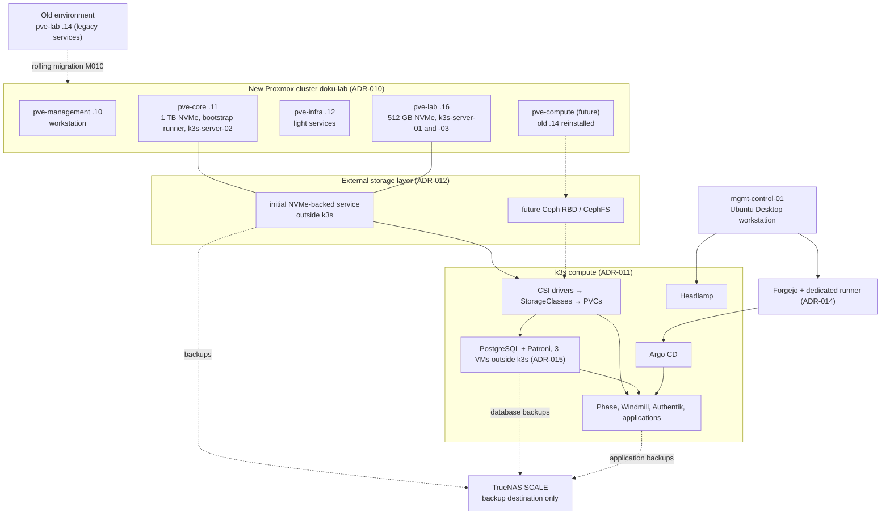

# Target homelab platform architecture

## Overview

The homelab is rebuilt as a reproducible platform declared in this repository. The rebuild is
**rolling** ([ADR-001](../decisions/ADR-001-rolling-infrastructure-rebuild.md)): the existing
infrastructure builds its replacement, services move one at a time, and reclaimed hardware is
reinstalled and joins the new cluster.

**Proxmox → k3s → Headlamp → external NVMe-backed storage / CSI → PostgreSQL + Patroni → Phase →
Argo CD + Windmill → applications.**

This document is the target. Deployed state is in milestone and task evidence; the legacy estate is
in [INV-legacy-inventory](../investigations/legacy-inventory.md); the current step is in the
[handoff](../handoff.md).

## Structure

### Layers and owners

Each layer has one owner; a tool never writes objects another layer owns.

| # | Layer | Technology | Owns | Never does |
|---|-------|------------|------|------------|
| 1 | Physical infrastructure | Proxmox VE cluster on `pve-management`, `pve-core`, reclaimed hosts ([ADR-010](../decisions/ADR-010-new-proxmox-cluster-on-pve-management.md)) | Compute, local NVMe, bridges | Application stacks or ad-hoc NFS exports on hypervisors |
| — | Provisioning / OS config | OpenTofu `bpg/proxmox` ([ADR-003](../decisions/ADR-003-opentofu-for-new-infrastructure.md)) / Ansible | VMs, disks, NICs / packages, users, k3s install | App topology |
| 2 | Kubernetes compute | k3s, embedded etcd ([ADR-011](../decisions/ADR-011-k3s-first-argocd-headlamp.md)) | Workload scheduling | Hold persistent data on its VM disks |
| 3 | Persistent storage | NVMe-backed service external to k3s; Ceph later ([ADR-012](../decisions/ADR-012-external-nvme-storage-truenas-backups.md)) | Volumes, their failure domain | Depend on the k3s cluster it serves |
| 4 | CSI integration | CSI driver of the chosen backend; StorageClasses (`nvme-block`, `nvme-shared`, later `ceph-rbd`, `cephfs`) | Dynamic PVC provisioning | Exist for a backend that does not support it |
| 5 | Central database | PostgreSQL 17 + Patroni on three VMs outside k3s, virtual IP 192.168.0.60 ([ADR-015](../decisions/ADR-015-postgresql-runs-on-three-patroni-vms-outside-k3s.md), [ADR-013](../decisions/ADR-013-central-postgresql-patroni.md)) | Per-application databases, roles, replication | Bootstrap k3s, store data on TrueNAS |
| 6 | Applications | Phase ([ADR-004](../decisions/ADR-004-secrets-phase-runtime-sops-bootstrap.md)), Windmill, Authentik, migrated services; Compose only for bootstrap exceptions | Their configuration | — |
| 7 | Management tools | Headlamp (UI), Argo CD (GitOps), Windmill (workflows, [ADR-005](../decisions/ADR-005-windmill-service-catalog.md)), Forgejo + dedicated runner ([ADR-014](../decisions/ADR-014-dedicated-forgejo-deployment-runner.md)), workstation `mgmt-control-01` ([ADR-009](../decisions/ADR-009-management-vm-gnome-admin-workstation.md)) | Inspect / reconcile / automate / execute | Duplicate each other or OpenTofu/Ansible |
| — | Inventory and IPAM | NetBox on k3s ([ADR-016](../decisions/ADR-016-netbox-is-the-inventory-and-ipam-source-of-truth-populated-f.md)); `scripts/netbox-sync.py` | The list of machines, hosts, addresses and ranges; what a person validated | Sit in the bootstrap path, hold credentials, write to Git or Proxmox |
| 8 | Backup storage | TrueNAS SCALE (and PBS for guests) | Storage, VM, database and application backups | Provide live PVCs (no TrueNAS CSI/NFS/iSCSI for applications) |
| — | Edge, identity, observability | Caddy and/or ingress, AdGuard Home, pfSense; Authentik on k3s ([ADR-017](../decisions/ADR-017-authentik-is-the-single-sign-on-of-the-platform-declared-in.md)); VictoriaMetrics, Loki, Grafana | HTTPS, DNS, routing; single sign-on (applications and groups from Git, people in Authentik); metrics, logs, alerts | Sit in the bootstrap path; replace a service's local administrator |

Secrets: Phase since 2026-11-18 (M008), with an age-encrypted recovery bundle for the bootstrap paths.

Inventory data has one authority per kind (ADR-016): Git for what the OpenTofu roots define, NetBox for
physical devices and for everything a person validated, the Proxmox API for what is merely observed.

### Hosts

Verified facts: [INV-new-proxmox-cluster-inventory](../investigations/new-proxmox-cluster-inventory.md).

| Host | Now | Target |
|------|-----|--------|
| `pve-management` 192.168.0.10 | New cluster; i5-10500T, 16 GB; runs `mgmt-control-01` (VM 100) | Management node: workstation |
| `pve-core` 192.168.0.11 | New cluster; i7-11700, 32 GB, 1 TB NVMe, a 25 Gb SFP28 card without cable yet | PostgreSQL member `pg-01` (VM 361, M007), k3s server `k3s-server-02` (VM 311, .41), LAN DNS `dns-01` (VM 370, AdGuard Home), a Tailscale router; the stopped desktop VMs |
| `pve-infra` 192.168.0.12 | New cluster (fresh install, reused name); N5095A, 8 GB, SATA SSD | Hosts nothing since 2026-11-24; will leave the cluster one day (operator) |
| `pve-lab` 192.168.0.16 | New cluster; Ryzen 7 6800H, 32 GB DDR5, 512 GB NVMe, 2.5 GbE | k3s server `k3s-server-03` (VM 312, .42); PostgreSQL member `pg-02` (VM 362, M007) |
| `pve-compute` 192.168.0.14 | New cluster since 2026-11-24 (the old environment's host, renamed); Ryzen 9 9950X3D, 32 GB, 1 TB and 2 TB NVMe, 10 Gb | The heavy work: both runners (`deploy-runner-01` VM 302, `ci-runner-01` VM 303), k3s server `k3s-server-01` (VM 310, .40, the ingress address), PostgreSQL member `pg-03` (VM 363), shared storage `storage-01` (VM 350, NFS for k3s user data, disks on the 2 TB NVMe, storage `lab-vms`) |
| `pve-k8s-01/02` | Legacy | Reclaimed after migration |
| TrueNAS SCALE | Serves Forgejo and datasets | Backup destination; current apps stay until replaced |

Two hosts are named `pve-lab`: always use the IP. Four votes give quorum 3 (one node may fail); one
corosync link and one SSD per node mean no physical HA is claimed (M011).

### Repository layout

Infrastructure code keeps the `terraform/` tree: new roots are OpenTofu roots under
`terraform/stacks/<host>-<purpose>/` reusing `terraform/modules/*`; legacy roots stay on Terraform
until migrated ([ADR-007](../decisions/ADR-007-archive-legacy-workflow-keep-live-roots.md)).
Ansible roles under `ansible/roles/`, workflows under `.forgejo/workflows/`, Kubernetes manifests and
Helm values reconciled by Argo CD in a directory chosen in M004/M009.

### State

OpenTofu state is local on the operator workstation (`mgmt-control-01`), one writer at a time, never
in Git. A shared backend is decided only when the dedicated runner must apply (TASK-010, M003).

## Key flows

- **New service:** define the deployment (manifests or Helm values) → Argo CD reconciles it on k3s →
  PVCs from the external NVMe-backed StorageClass → database and role on the central PostgreSQL →
  secrets from Phase (Infisical until then) → ingress/DNS → health check. Windmill may trigger the
  workflow; every step stays runnable from the workstation.
- **Migrate a service (M010):** deploy the replacement, copy its data, configure database and secrets,
  validate, cut over, retire the old workload only after validation.
- **Change a service on k3s:** edit its values or manifests in `services/<name>/` → merge to `main` → Argo
  CD applies it (applications: `services/argocd/apps/`). A new service adds a directory, an Application, and
  a Make target only if it needs a Secret from the secret store.
- **Inventory:** a root is applied from its own variables → `make netbox-discover` snapshots Proxmox
  read-only → `make netbox-plan` shows the difference and what needs a decision → `make netbox-apply`
  writes it. Ansible runs across roots read `ansible/inventories/netbox.yml`; each root's own
  configuration run keeps the inventory from its OpenTofu output, so nothing needs NetBox to be rebuilt.
- **Reclaim a host:** confirm it is empty → guard legacy roots → reinstall Proxmox → join the cluster
  → add k3s and storage capacity.

## Constraints

- No apply/destroy, reinstall, cluster, storage, network, firewall or credential change without
  explicit operator approval of that operation.
- Never destroy an original workload or its data before the replacement works.
- Single-host storage is never labelled HA; no Ceph on too few nodes.
- Validation CI receives no infrastructure credentials; CT301 stays validation-only.
- Verify licences and self-hosting support (Phase, operators, charts) when their milestone starts.
