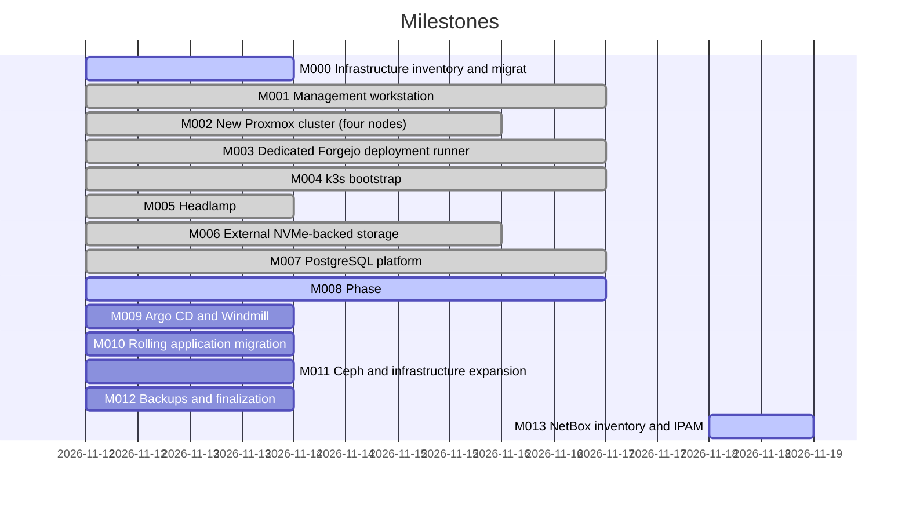

# Dashboard

Generated by `harness docs index`. Do not edit; regenerate instead.

## Milestones

| ID | Status | Priority | Title | Progress |
|----|--------|----------|-------|----------|
| M000 | active | critical | [Infrastructure inventory and migration planning](../milestones/M000-inventory-and-migration-planning.md) | ░░░░░░░░░░ 0/2 |
| M001 | completed | critical | [Management workstation](../milestones/M001-bootstrap-pve-management.md) | ████████░░ 4/5 |
| M002 | completed | critical | [New Proxmox cluster (four nodes)](../milestones/M002-proxmox-compute-capacity.md) | ██████████ 1/1 |
| M003 | completed | high | [Dedicated Forgejo deployment runner](../milestones/M003-deployment-runner.md) | ██████████ 1/1 |
| M004 | completed | high | [k3s bootstrap](../milestones/M004-k3s-bootstrap.md) | ██████████ 2/2 |
| M005 | completed | high | [Headlamp](../milestones/M005-headlamp.md) | ██████████ 1/1 |
| M006 | completed | high | [External NVMe-backed storage](../milestones/M006-external-nvme-storage.md) | ██████████ 1/1 |
| M007 | completed | high | [PostgreSQL platform](../milestones/M007-postgresql-platform.md) | ██████████ 1/1 |
| M008 | active | high | [Phase](../milestones/M008-phase.md) | ░░░░░░░░░░ 0/1 |
| M009 | planned | medium | [Argo CD and Windmill](../milestones/M009-argocd-windmill.md) | ░░░░░░░░░░ 0/0 |
| M010 | planned | high | [Rolling application migration](../milestones/M010-rolling-application-migration.md) | ██░░░░░░░░ 1/4 |
| M011 | planned | medium | [Ceph and infrastructure expansion](../milestones/M011-ceph-and-expansion.md) | ░░░░░░░░░░ 0/0 |
| M012 | planned | medium | [Backups and finalization](../milestones/M012-backups-and-finalization.md) | ░░░░░░░░░░ 0/3 |
| M013 | active | medium | [NetBox inventory and IPAM](../milestones/M013-netbox-inventory-and-ipam.md) | ██████████ 1/1 |

## Timeline

## Task board

### in-progress

| ID | Priority | Milestone | Title |
|----|----------|-----------|-------|
| TASK-001 | critical | M000 | [Reset repository to the agent harness and record the rebuild direction](../tasks/TASK-001-repository-reset-and-alignment.md) |
| TASK-006 | critical | M001 | [Target repository layout, OpenTofu toolchain and management Make targets](../tasks/TASK-006-target-layout-and-service-contract.md) |
| TASK-019 | high | M008 | [Phase on k3s with the shared PostgreSQL and migration from Infisical](../tasks/TASK-019-phase-on-k3s-with-the-shared-postgresql-and-migration-from-i.md) |
| TASK-022 | high | M010 | [Edge migration: certificates, Caddy sites on Traefik, AdGuard as code](../tasks/TASK-022-edge-migration-certificates-caddy-sites-on-traefik-adguard-a.md) |

### planned

| ID | Priority | Milestone | Title |
|----|----------|-----------|-------|
| TASK-002 | critical | M000 | [Live read-only inventory of Proxmox hosts, guests and storage](../tasks/TASK-002-live-proxmox-inventory.md) |
| TASK-011 | critical | M012 | [SOPS + age bootstrap secrets](../tasks/TASK-011-sops-age-bootstrap-secrets.md) |
| TASK-003 | high | M010 | [Service dependency, network/DNS and data/backup map](../tasks/TASK-003-service-dependency-and-data-map.md) |
| TASK-004 | high | M012 | [Representative PBS restore test](../tasks/TASK-004-pbs-representative-restore.md) |
| TASK-005 | high | M010 | [Migration order and bootstrap credential requirements](../tasks/TASK-005-migration-order-and-bootstrap-credentials.md) |
| TASK-012 | high | M012 | [Independent bootstrap and recovery runbook](../tasks/TASK-012-bootstrap-and-recovery-runbook.md) |

### completed

| ID | Priority | Milestone | Title |
|----|----------|-----------|-------|
| TASK-023 | medium | M013 | [NetBox on k3s, initial inventory, reconciliation and Ansible inventory](../tasks/TASK-023-netbox-on-k3s-initial-inventory-reconciliation-and-ansible-i.md) |
| TASK-021 | medium | M004 | [k3s servers on pve-core and pve-lab: three etcd members](../tasks/TASK-021-k3s-servers-on-pve-core-and-pve-lab-three-etcd-members.md) |
| TASK-020 | medium | M010 | [Lean observability: Prometheus, Loki, Grafana and Alloy](../tasks/TASK-020-lean-observability-prometheus-loki-grafana-and-alloy.md) |
| TASK-018 | high | M007 | [PostgreSQL platform: three Patroni VMs outside k3s with a virtual IP](../tasks/TASK-018-postgresql-platform-three-patroni-vms-outside-k3s-with-a-vir.md) |
| TASK-017 | high | M006 | [Shared NFS storage VM on pve-core and nvme-shared StorageClass](../tasks/TASK-017-shared-nfs-storage-vm-on-pve-core-and-nvme-shared-storagecla.md) |
| TASK-016 | high | M005 | [Headlamp on k3s with LAN-only ingress and token login](../tasks/TASK-016-headlamp-on-k3s-with-lan-only-ingress-and-token-login.md) |
| TASK-015 | high | M004 | [k3s cluster on doku-lab: first server on pve-lab](../tasks/TASK-015-k3s-cluster-on-doku-lab-first-server-on-pve-lab.md) |
| TASK-014 | high | M003 | [Bootstrap deployment runner VM on pve-core](../tasks/TASK-014-bootstrap-deployment-runner-vm.md) |
| TASK-009 | high | M001 | [Ansible baseline for the management VM (toolchain and runner)](../tasks/TASK-009-management-vm-ansible-baseline.md) |
| TASK-013 | critical | M002 | [Reinstall pve-core and form the new Proxmox cluster](../tasks/TASK-013-reinstall-pve-core-and-form-cluster.md) |
| TASK-010 | critical | M001 | [OpenTofu state: one local authority, handed over to the workstation](../tasks/TASK-010-state-management-and-backups.md) |
| TASK-008 | critical | M001 | [Reusable OpenTofu guest module and management VM root](../tasks/TASK-008-proxmox-guest-module-and-management-vm.md) |
| TASK-007 | critical | M001 | [Scoped Proxmox API token and SSH access for pve-management](../tasks/TASK-007-pve-management-access.md) |

## Verification

- `git diff --check` — whitespace
- `.venv/bin/harness check` — harness-check
- `.venv/bin/python scripts/check-quality.py` — quality
- `terraform fmt -check -recursive terraform` — terraform-fmt
- `d="$(mktemp -d)"; for r in terraform/stacks/*/ terraform/examples/cloud-image-vm/; do case "$r" in terraform/stacks/pve-management-control/|terraform/stacks/deploy-runner/|terraform/stacks/ci-disposable/|terraform/stacks/k3s/|terraform/stacks/storage/|terraform/stacks/postgresql/|terraform/stacks/dns/) continue;; esac; n="$d/$(basename "$r")"; TF_DATA_DIR="$n" terraform -chdir="$r" init -backend=false -input=false -lockfile=readonly >/dev/null && TF_DATA_DIR="$n" terraform -chdir="$r" validate >/dev/null || { echo "FAIL $r"; exit 1; }; done; rm -rf "$d"` — terraform-validate
- `make mgmt-check` — mgmt-check
- `make deploy-runner-check` — deploy-runner-check
- `make k3s-cluster-check` — k3s-cluster-check
- `make storage-check` — storage-check
- `make postgresql-check` — postgresql-check
- `make dns-check` — dns-check
- `make phase-check` — phase-check
- `make observability-check` — observability-check
- `make ingress-check` — ingress-check
- `make netbox-check` — netbox-check
- `make headlamp-check` — headlamp-check
- `for p in ansible/playbooks/*.yml; do .venv/bin/ansible-playbook --syntax-check -i ansible/inventories/homelab.yml "$p" >/dev/null || exit 1; done` — ansible-syntax
- `docker-compose -f services/monitoring/compose.yml config --quiet && DB_PASSWORD=synthetic-ci-only docker-compose -f services/windmill/compose.yml config --quiet` — compose-config
- `for t in windmill runner-connections tfstate-backups tailscale-routers vm-profiles stage-a stage-a-inputs k3s-bootstrap flux-demo homepage; do .venv/bin/python "tests/$t.py" || exit 1; done` — offline-tests

## Needs attention

_Nothing._
