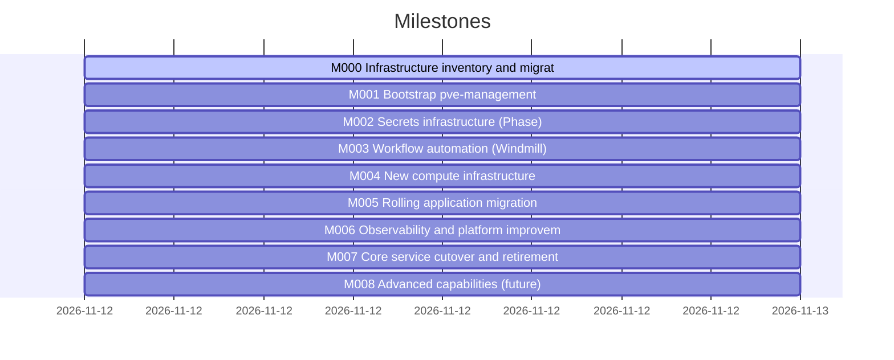

# Dashboard

Generated by `harness docs index`. Do not edit; regenerate instead.

## Milestones

| ID | Status | Priority | Title | Progress |
|----|--------|----------|-------|----------|
| M000 | active | critical | [Infrastructure inventory and migration planning](../milestones/M000-inventory-and-migration-planning.md) | ░░░░░░░░░░ 0/5 |
| M001 | planned | critical | [Bootstrap pve-management](../milestones/M001-bootstrap-pve-management.md) | ░░░░░░░░░░ 0/7 |
| M002 | planned | high | [Secrets infrastructure (Phase)](../milestones/M002-secrets-infrastructure.md) | ░░░░░░░░░░ 0/0 |
| M003 | planned | high | [Workflow automation (Windmill)](../milestones/M003-workflow-automation.md) | ░░░░░░░░░░ 0/0 |
| M004 | planned | high | [New compute infrastructure](../milestones/M004-new-compute-infrastructure.md) | ░░░░░░░░░░ 0/0 |
| M005 | planned | high | [Rolling application migration](../milestones/M005-rolling-application-migration.md) | ░░░░░░░░░░ 0/0 |
| M006 | planned | medium | [Observability and platform improvements](../milestones/M006-observability.md) | ░░░░░░░░░░ 0/0 |
| M007 | planned | medium | [Core service cutover and retirement](../milestones/M007-core-service-cutover.md) | ░░░░░░░░░░ 0/0 |
| M008 | planned | low | [Advanced capabilities (future)](../milestones/M008-advanced-capabilities.md) | ░░░░░░░░░░ 0/0 |

## Timeline

## Task board

### in-progress

| ID | Priority | Milestone | Title |
|----|----------|-----------|-------|
| TASK-001 | critical | M000 | [Reset repository to the agent harness and record the rebuild direction](../tasks/TASK-001-repository-reset-and-alignment.md) |

### planned

| ID | Priority | Milestone | Title |
|----|----------|-----------|-------|
| TASK-002 | critical | M000 | [Live read-only inventory of Proxmox hosts, guests and storage](../tasks/TASK-002-live-proxmox-inventory.md) |
| TASK-006 | critical | M001 | [Target repository layout, OpenTofu toolchain and management Make targets](../tasks/TASK-006-target-layout-and-service-contract.md) |
| TASK-007 | critical | M001 | [Scoped Proxmox API token and SSH access for pve-management](../tasks/TASK-007-pve-management-access.md) |
| TASK-008 | critical | M001 | [Reusable OpenTofu guest module and management VM root](../tasks/TASK-008-proxmox-guest-module-and-management-vm.md) |
| TASK-010 | critical | M001 | [OpenTofu state management and backups](../tasks/TASK-010-state-management-and-backups.md) |
| TASK-011 | critical | M001 | [SOPS + age bootstrap secrets](../tasks/TASK-011-sops-age-bootstrap-secrets.md) |
| TASK-003 | high | M000 | [Service dependency, network/DNS and data/backup map](../tasks/TASK-003-service-dependency-and-data-map.md) |
| TASK-004 | high | M000 | [Representative PBS restore test](../tasks/TASK-004-pbs-representative-restore.md) |
| TASK-005 | high | M000 | [Migration order and bootstrap credential requirements](../tasks/TASK-005-migration-order-and-bootstrap-credentials.md) |
| TASK-009 | high | M001 | [Ansible baseline for the management VM (toolchain and runner)](../tasks/TASK-009-management-vm-ansible-baseline.md) |
| TASK-012 | high | M001 | [Independent bootstrap and recovery runbook](../tasks/TASK-012-bootstrap-and-recovery-runbook.md) |

## Verification

- `git diff --check` — whitespace
- `.venv/bin/harness check` — harness-check
- `.venv/bin/python scripts/check-quality.py` — quality
- `terraform fmt -check -recursive terraform` — terraform-fmt
- `d="$(mktemp -d)"; for r in terraform/stacks/*/ terraform/examples/cloud-image-vm/; do n="$d/$(basename "$r")"; TF_DATA_DIR="$n" terraform -chdir="$r" init -backend=false -input=false -lockfile=readonly >/dev/null && TF_DATA_DIR="$n" terraform -chdir="$r" validate >/dev/null || { echo "FAIL $r"; exit 1; }; done; rm -rf "$d"` — terraform-validate
- `for p in ansible/playbooks/*.yml; do .venv/bin/ansible-playbook --syntax-check -i ansible/inventories/homelab.yml "$p" >/dev/null || exit 1; done` — ansible-syntax
- `docker-compose -f services/monitoring/compose.yml config --quiet && DB_PASSWORD=synthetic-ci-only docker-compose -f services/windmill/compose.yml config --quiet` — compose-config
- `for t in windmill runner-connections tfstate-backups tailscale-routers vm-profiles stage-a stage-a-inputs k3s-bootstrap flux-demo homepage; do .venv/bin/python "tests/$t.py" || exit 1; done` — offline-tests

## Needs attention

_Nothing._
