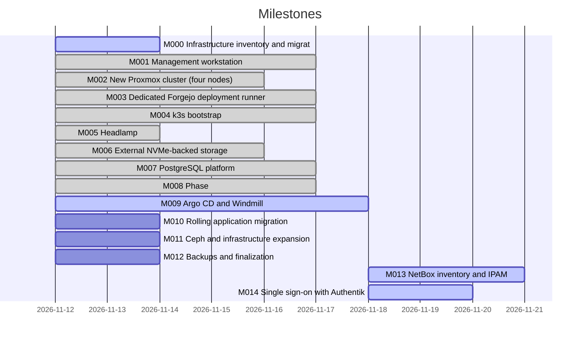

# Dashboard

> **ID:** INDEX-dashboard · **Type:** index · **Status:** generated · [Source](https://git.doku-lab.net/Homelab/homelab-iac/src/branch/main/docs/dashboard.md)

Generated by `harness docs index`. Do not edit; regenerate instead.

## Milestones

| ID | Status | Priority | Title | Progress |
|----|--------|----------|-------|----------|
| M000 | active | critical | [Infrastructure inventory and migration planning](/milestones/m000-inventory-and-migration-planning) | ░░░░░░░░░░ 0/2 |
| M001 | completed | critical | [Management workstation](/milestones/m001-bootstrap-pve-management) | ████████░░ 5/6 |
| M002 | completed | critical | [New Proxmox cluster (four nodes)](/milestones/m002-proxmox-compute-capacity) | ██████████ 1/1 |
| M003 | completed | high | [Dedicated Forgejo deployment runner](/milestones/m003-deployment-runner) | ██████████ 1/1 |
| M004 | completed | high | [k3s bootstrap](/milestones/m004-k3s-bootstrap) | ██████████ 2/2 |
| M005 | completed | high | [Headlamp](/milestones/m005-headlamp) | ██████████ 1/1 |
| M006 | completed | high | [External NVMe-backed storage](/milestones/m006-external-nvme-storage) | ██████████ 1/1 |
| M007 | completed | high | [PostgreSQL platform](/milestones/m007-postgresql-platform) | ██████████ 1/1 |
| M008 | completed | high | [Phase](/milestones/m008-phase) | ░░░░░░░░░░ 0/1 |
| M009 | active | medium | [Argo CD and Windmill](/milestones/m009-argocd-windmill) | ██████████ 2/2 |
| M010 | planned | high | [Rolling application migration](/milestones/m010-rolling-application-migration) | █████░░░░░ 7/12 |
| M011 | planned | medium | [Ceph and infrastructure expansion](/milestones/m011-ceph-and-expansion) | ░░░░░░░░░░ 0/0 |
| M012 | planned | medium | [Backups and finalization](/milestones/m012-backups-and-finalization) | ░░░░░░░░░░ 0/3 |
| M013 | active | medium | [NetBox inventory and IPAM](/milestones/m013-netbox-inventory-and-ipam) | █████░░░░░ 1/2 |
| M014 | active | medium | [Single sign-on with Authentik](/milestones/m014-single-sign-on-with-authentik) | ██████████ 1/1 |

## Timeline

## Task board

### in-progress

| ID | Priority | Milestone | Title |
|----|----------|-----------|-------|
| TASK-001 | critical | M000 | [Reset repository to the agent harness and record the rebuild direction](/tasks/task-001-repository-reset-and-alignment) |
| TASK-006 | critical | M001 | [Target repository layout, OpenTofu toolchain and management Make targets](/tasks/task-006-target-layout-and-service-contract) |
| TASK-019 | high | M008 | [Phase on k3s with the shared PostgreSQL and migration from Infisical](/tasks/task-019-phase-on-k3s-with-the-shared-postgresql-and-migration-from-i) |
| TASK-022 | high | M010 | [Edge migration: certificates, Caddy sites on Traefik, AdGuard as code](/tasks/task-022-edge-migration-certificates-caddy-sites-on-traefik-adguard-a) |
| TASK-030 | medium | M013 | [NetBox as the full inventory: real hardware, ports, cables, guests and diagram plugins](/tasks/task-030-netbox-as-the-full-inventory-real-hardware-ports-cables-gues) |
| TASK-035 | medium | M010 | [Documentation maps: hub pages generated from the repository and a wiki with a curated sidebar](/tasks/task-035-documentation-maps-hub-pages-generated-from-the-repository-a) |
| TASK-036 | medium | M010 | [Media stack on pve-infra: Jellyfin, Seerr, Radarr, Sonarr, Prowlarr and qBittorrent on a Compose VM](/tasks/task-036-media-stack-on-pve-infra-jellyfin-seerr-radarr-sonarr-prowla) |

### planned

| ID | Priority | Milestone | Title |
|----|----------|-----------|-------|
| TASK-002 | critical | M000 | [Live read-only inventory of Proxmox hosts, guests and storage](/tasks/task-002-live-proxmox-inventory) |
| TASK-011 | critical | M012 | [SOPS + age bootstrap secrets](/tasks/task-011-sops-age-bootstrap-secrets) |
| TASK-003 | high | M010 | [Service dependency, network/DNS and data/backup map](/tasks/task-003-service-dependency-and-data-map) |
| TASK-004 | high | M012 | [Representative PBS restore test](/tasks/task-004-pbs-representative-restore) |
| TASK-005 | high | M010 | [Migration order and bootstrap credential requirements](/tasks/task-005-migration-order-and-bootstrap-credentials) |
| TASK-012 | high | M012 | [Independent bootstrap and recovery runbook](/tasks/task-012-bootstrap-and-recovery-runbook) |

### completed

| ID | Priority | Milestone | Title |
|----|----------|-----------|-------|
| TASK-034 | medium | M010 | [VictoriaMetrics replaces Prometheus; vmalert evaluates the rules](/tasks/task-034-victoriametrics-replaces-prometheus-vmalert-evaluates-the-ru) |
| TASK-033 | medium | M010 | [Clean CI runner ci-runner-01 on the new cluster, replacing CT301](/tasks/task-033-clean-ci-runner-ci-runner-01-on-the-new-cluster-replacing-ct) |
| TASK-032 | medium | M010 | [Vaultwarden on k3s with its vault in the shared PostgreSQL](/tasks/task-032-vaultwarden-on-k3s-with-its-vault-in-the-shared-postgresql) |
| TASK-031 | medium | M010 | [Switch port counters over SNMP in Prometheus and Grafana](/tasks/task-031-switch-port-counters-over-snmp-in-prometheus-and-grafana) |
| TASK-029 | medium | M010 | [Wiki.js 3 on k3s showing this repository's documentation](/tasks/task-029-wiki-js-3-on-k3s-showing-this-repository-s-documentation) |
| TASK-028 | medium | M001 | [Workstation VM renders on the host's graphics adapter](/tasks/task-028-workstation-vm-renders-on-the-host-s-graphics-adapter) |
| TASK-027 | medium | M010 | [Homepage on k3s behind Authentik, rearranged for the doku-lab cluster, with a new widget data API](/tasks/task-027-homepage-on-k3s-behind-authentik-rearranged-for-the-doku-lab) |
| TASK-026 | medium | M014 | [Authentik on k3s and single sign-on for Argo CD, Grafana, NetBox and Windmill](/tasks/task-026-authentik-on-k3s-and-single-sign-on-for-argo-cd-grafana-netb) |
| TASK-025 | medium | M009 | [Windmill on k3s reading its data from NetBox](/tasks/task-025-windmill-on-k3s-reading-its-data-from-netbox) |
| TASK-024 | medium | M009 | [Argo CD on k3s and every service of the cluster under it](/tasks/task-024-argo-cd-on-k3s-and-netbox-as-its-first-application) |
| TASK-023 | medium | M013 | [NetBox on k3s, initial inventory, reconciliation and Ansible inventory](/tasks/task-023-netbox-on-k3s-initial-inventory-reconciliation-and-ansible-i) |
| TASK-021 | medium | M004 | [k3s servers on pve-core and pve-lab: three etcd members](/tasks/task-021-k3s-servers-on-pve-core-and-pve-lab-three-etcd-members) |
| TASK-020 | medium | M010 | [Lean observability: Prometheus, Loki, Grafana and Alloy](/tasks/task-020-lean-observability-prometheus-loki-grafana-and-alloy) |
| TASK-018 | high | M007 | [PostgreSQL platform: three Patroni VMs outside k3s with a virtual IP](/tasks/task-018-postgresql-platform-three-patroni-vms-outside-k3s-with-a-vir) |
| TASK-017 | high | M006 | [Shared NFS storage VM on pve-core and nvme-shared StorageClass](/tasks/task-017-shared-nfs-storage-vm-on-pve-core-and-nvme-shared-storagecla) |
… and 8 more

## Verification

- `git diff --check` — whitespace
- `.venv/bin/harness check` — harness-check
- `.venv/bin/python scripts/check-quality.py` — quality
- `terraform fmt -check -recursive terraform` — terraform-fmt
- `d="$(mktemp -d)"; for r in terraform/stacks/*/ terraform/examples/cloud-image-vm/; do case "$r" in terraform/stacks/pve-management-control/|terraform/stacks/deploy-runner/|terraform/stacks/ci-runner/|terraform/stacks/ci-disposable/|terraform/stacks/k3s/|terraform/stacks/storage/|terraform/stacks/postgresql/|terraform/stacks/dns/|terraform/stacks/media/) continue;; esac; n="$d/$(basename "$r")"; TF_DATA_DIR="$n" terraform -chdir="$r" init -backend=false -input=false -lockfile=readonly >/dev/null && TF_DATA_DIR="$n" terraform -chdir="$r" validate >/dev/null || { echo "FAIL $r"; exit 1; }; done; rm -rf "$d"` — terraform-validate
- `make mgmt-check` — mgmt-check
- `make deploy-runner-check` — deploy-runner-check
- `make k3s-cluster-check` — k3s-cluster-check
- `make storage-check` — storage-check
- `make postgresql-check` — postgresql-check
- `make ci-runner-check` — ci-runner-check
- `make dns-check` — dns-check
- `make media-check` — media-check
- `make phase-check` — phase-check
- `make observability-check` — observability-check
- `make ingress-check` — ingress-check
- `make argocd-check` — argocd-check
- `make windmill-k3s-check` — windmill-k3s-check
- `make homepage-k3s-check` — homepage-k3s-check
- `make wiki-check` — wiki-check
- `make authentik-check` — authentik-check
- `make netbox-check` — netbox-check
- `make headlamp-check` — headlamp-check
- `for p in ansible/playbooks/*.yml; do .venv/bin/ansible-playbook --syntax-check -i ansible/inventories/homelab.yml "$p" >/dev/null || exit 1; done` — ansible-syntax
- `docker-compose -f services/monitoring/compose.yml config --quiet && DB_PASSWORD=synthetic-ci-only docker-compose -f services/windmill/compose.yml config --quiet` — compose-config
- `for t in windmill runner-connections tfstate-backups tailscale-routers vm-profiles stage-a stage-a-inputs k3s-bootstrap flux-demo homepage; do .venv/bin/python "tests/$t.py" || exit 1; done` — offline-tests

## Needs attention

_Nothing._
