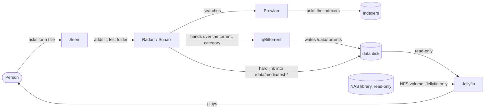

# Media stack: Jellyfin, Seerr, Radarr, Sonarr, Prowlarr and qBittorrent on media-01

A test of a complete self-hosted media chain beside Plex, which keeps running on the NAS and is not touched
(TASK-036, built 2026-11-26). Everything is one VM, `media-01`, under Docker Compose, outside k3s by the
operator's choice.

## What runs where

| Piece | Where | Detail |
|---|---|---|
| VM `media-01` | `pve-infra`, VM 380, `192.168.0.80` | Debian 13 (generic cloud image: its kernel has the graphics driver), 4 cores, 5.5 GiB, root `terraform/stacks/media` |
| System disk | 16 GiB, `local-lvm` | Debian, Docker, images |
| Data disk | 140 GiB thin, `local-lvm`, mounted on `/srv/media` | `config/` (every application), `cache/jellyfin`, `data/` (the test area), `backups/` |
| Graphics adapter | host device `0000:00:02.0` (Jasper Lake UHD), passed to the VM | Proxmox resource mapping `igpu`; in the VM `/dev/dri/renderD128`, given to Jellyfin only |
| Databases | shared PostgreSQL, `192.168.0.60`, TLS | `seerr`; `radarr` + `radarr_log`; `sonarr` + `sonarr_log`; `prowlarr` + `prowlarr_log`. Jellyfin: SQLite in `config/jellyfin` (the only database it supports) |
| Compose project | `/opt/media/compose.yml`, secrets in `/opt/media/.env` (root, 0600) | written by the role `media_stack` |

The host is a Celeron **N5095A** (Jasper Lake), not an N95; 4 threads and 7.6 GiB of memory, of which the VM
holds 5.5 GiB (pinned, because of the passed device). Nothing else runs on `pve-infra`.

| Application | Image (pinned in `ansible/vars/media.yml`) | Address | Sign-in |
|---|---|---|---|
| Jellyfin | `jellyfin/jellyfin:12.4` | <https://jellyfin.doku-lab.net>, `http://192.168.0.80:8096` | its own accounts; administrator `admin`, password in the store (`/media`, `MEDIA_ADMIN_PASSWORD`) |
| Seerr | `ghcr.io/seerr-team/seerr:v3.5.2` | <https://seerr.doku-lab.net>, `http://192.168.0.80:5055` | Jellyfin's accounts |
| Radarr | `lscr.io/linuxserver/radarr:7.0.3.10918-ls328` | <https://media.doku-lab.net/radarr/> | Authentik (group `homelab-admins`) |
| Sonarr | `lscr.io/linuxserver/sonarr:4.0.20.3014-ls6` | <https://media.doku-lab.net/sonarr/> | Authentik |
| Prowlarr | `lscr.io/linuxserver/prowlarr:3.1.0.5799-ls170` | <https://media.doku-lab.net/prowlarr/> | Authentik |
| qBittorrent | `qbittorrentofficial/qbittorrent-nox:5.3.1-1` | <https://media.doku-lab.net/qbittorrent/> | Authentik |

The names answer on the LAN only (Traefik on k3s, `services/media/access.yaml`). The four tools are behind
Authentik's forward authentication under one name and one session; the VM's firewall lets nobody but the k3s
nodes reach their ports, so the tools do not ask for their own sign-in from private addresses. Each keeps its
own administrator (`admin`, same password in the store) for the day Authentik or k3s is down:

```
ssh -L 7878:127.0.0.1:7878 -L 8989:127.0.0.1:8989 -L 9696:127.0.0.1:9696 -L 8080:127.0.0.1:8080 debian@192.168.0.80
```

then `http://localhost:7878/radarr/` and so on. Jellyfin and Seerr are **not** behind Authentik: television
and phone applications cannot pass it, and Seerr signs people in with their Jellyfin account. This is the
one deliberate exception to "every web interface signs in through Authentik" (ADR-017).

## How a request travels



- **Seerr**: the catalogue people browse and the button "Request". It knows what Jellyfin already has.
- **Radarr** (movies) and **Sonarr** (series): keep the list of wanted titles, pick a release, follow the
  download, then name the file and put it in the library.
- **Prowlarr**: one place for the indexers (the sites that list torrents); it pushes them to Radarr and Sonarr.
- **qBittorrent**: downloads and seeds.
- **Jellyfin**: the library people watch, and the transcoding when a device cannot play a file as it is.

## Storage and the protection of the Plex library

One tree on the VM's data disk is mounted as `/data` in every container that needs it, so an import is a
**hard link**: instant, no second copy, and the torrent keeps seeding.

```
/srv/media/data/                (in containers: /data)       THE TEST AREA
  torrents/                     qBittorrent writes here
  media/test-movies/            Radarr's only root folder
  media/test-series/            Sonarr's only root folder
```

| Container | Sees |
|---|---|
| qBittorrent | `/data/torrents` |
| Radarr, Sonarr | `/data` (downloads and the test library) |
| Prowlarr, Seerr | no media at all |
| Jellyfin | `/data/media` read-only, and the NAS library read-only under `/data/nas` |

Radarr, Sonarr and qBittorrent have **no path to the NAS**: they cannot rename, replace or delete anything of
the Plex library whatever their settings say. Jellyfin's view of the NAS is read-only twice (the share is
mounted `ro`, and so is the volume).

The NAS share is a Docker NFS volume, mounted by Docker when Jellyfin starts. When the NAS does not answer,
Jellyfin does not start; it never shows an empty local directory in its place. The data disk is protected the
same way: Docker itself does not start when `/srv/media` is not mounted.

### NAS: what the operator still has to do

On 2026-11-26 the NAS (TrueNAS, `192.168.0.13`) offered **no NFS export** (`showmount -e` empty), its SMB
shares refuse anonymous access, its SSH port does not answer and the secret store holds no NAS account. So
the existing library is not mounted yet and Jellyfin shows the test libraries only.

1. In TrueNAS: *Shares → Unix (NFS) Shares → Add*. Path: the dataset Plex reads (for example
   `/mnt/tank/media`). *Read-only*: on. *Hosts*: `192.168.0.80`. *Maproot user*: leave empty (a read-only
   share needs no root). This adds a share; it changes no permission of the dataset and nothing for Plex.
   The files must be readable by "others" (or map the share's user to the one that owns them:
   *Mapall user*).
2. In `ansible/vars/media.yml`: set `media_nas_export` to that path and list the libraries, for example
   `- {name: "Movies (NAS)", type: movies, path: Movies}`.
3. `scripts/secrets.py run /media /postgresql -- make media-configure MEDIA_CONFIGURE_APPROVED=yes`, then
   `make media-status`: it shows the mount as Jellyfin sees it and that a write is refused.

## Operation

```
make media-check                                  offline tests
make media-status                                 containers, health, mounts, databases, graphics adapter
scripts/secrets.py run /media /postgresql -- make media-configure MEDIA_CONFIGURE_APPROVED=yes
                                                  after any change in ansible/vars/media.yml (image versions,
                                                  NAS export); MEDIA_ANSIBLE_ARGS="--tags connect" only re-runs
                                                  the connections between the applications
make media-backup                                 archive now and copy it to .local/media-backups/
```

Upgrade: change the image tag in `ansible/vars/media.yml`, run `media-configure`. Radarr, Sonarr and Prowlarr
update their database schema by themselves at start; take an archive first.

On the VM: `cd /opt/media && sudo docker compose ps | logs -f <service> | restart <service>`.

The VM's shape (cores, memory, disk size, graphics adapter) is `terraform/stacks/media/terraform.tfvars`
(private, from `terraform.tfvars.example`): `make media-plan MEDIA_ALLOCATION_REVIEWED=yes`, then
`make media-apply` with the printed checksum. A change of the passed device or of the memory needs the VM
stopped and started (`qm shutdown 380 && qm start 380` on `pve-infra`).

## Indexers, and a safe test of one movie and one series

No indexer is configured: that needs accounts or choices only the operator has. In Prowlarr
(<https://media.doku-lab.net/prowlarr/>): *Indexers → Add*, pick one, fill its fields, *Test*, *Save*.
It then appears in Radarr and Sonarr by itself (*Settings → Indexers*). Use sources you are entitled to.

One movie:

1. <https://seerr.doku-lab.net>, sign in with a Jellyfin account, search the title, *Request*.
2. Radarr → *Movies*: the title is there, path `/data/media/test-movies/...`. *Activity → Queue* shows the
   download once an indexer has a release (or *Search* on the movie's page, then pick a release).
3. qBittorrent: the torrent, category `radarr`, saved under `/data/torrents`.
4. When it completes, Radarr imports it: the file appears under *Movies → the title → Files*.
5. Jellyfin → *Test movies*: the title appears within a minute (real-time monitoring) and plays.

One series: the same in Seerr (pick the seasons), then Sonarr → *Series*, category `sonarr`, Jellyfin →
*Test series*.

Everything lands in the test area. To start again from nothing: remove the titles in Radarr/Sonarr with
their files, remove the torrents in qBittorrent with their data; `/srv/media/data` is safe to empty.

Before the stack is given real work: decide whether torrent traffic leaves through the home connection or
through a VPN container in front of qBittorrent (not set up), and whether Radarr and Sonarr may one day write
to the NAS (they would need a writable share of their own, never the Plex dataset).

## Hardware transcoding

Jasper Lake decodes and encodes H.264, HEVC 8 and 10 bit and VP9 in hardware; it has **no AV1**, and it
encodes in low-power mode only, which needs the HuC firmware. The role installs `firmware-intel-graphics`,
sets `i915.enable_guc=2` in the VM and configures Jellyfin for VA-API with the low-power encoders (Jellyfin's
documentation says Quick Sync is being retired for this generation on Linux).

- The adapter belongs to the VM while it runs: the host's own screen output is dark; its web interface and
  SSH are unaffected. The VM cannot be moved live.
- Check: `make media-status` (driver, encoders) and, in Jellyfin, *Dashboard → Playback → Transcoding*.
- During a playback that transcodes: *Dashboard → Activity* shows the session with "Transcoding (… VAAPI)";
  on the VM, `sudo intel_gpu_top` shows the Video engine busy.
- To give the adapter back to the host: `gpu_mapping = null` in the private tfvars, plan, apply, stop and
  start the VM, then `media-configure` (Jellyfin falls back to software transcoding).

## Database access, backup and recovery

- Access: each application signs in to PostgreSQL with its own role, which can reach only its own databases,
  from `192.168.0.80` only, over TLS (`ansible/roles/patroni_postgresql`: `pg_hba` and the members'
  firewall). The roles own their databases and are not superusers. Prowlarr's documentation asks for a
  superuser for one housekeeping task (a vacuum); as owner it can vacuum its own tables, so that is not given.
- The databases follow the primary of the Patroni cluster through the virtual IP: a failover of PostgreSQL
  needs nothing here beyond the applications reconnecting.
- **The platform has no database backups yet** (M012). Radarr, Sonarr and Prowlarr do not back up their
  PostgreSQL databases themselves either. Until M012, the stack carries its own: `media-backup.timer`
  (every night, 04:30 UTC) writes `/srv/media/backups/media-<date>.tar.zst`, seven kept, with a `pg_dump` of the
  seven databases, a consistent copy of each SQLite database (Jellyfin) and the configuration directories
  (without caches, logs and what Jellyfin can download again). That archive is on the same disk as the data:
  it protects against a broken upgrade or a mistake, not against losing the disk. `make media-backup` copies
  the newest one to the workstation; put it somewhere else when the stack holds anything that matters.
- The VM itself is rebuildable from Git: `make media-plan` / `media-apply`, `media-hostkeys`,
  `media-configure`. The secrets are in the store (`/media`, `/postgresql`).

Restore after losing the VM or its data disk:

1. Rebuild the VM (above) and run `media-configure` once: empty applications on empty databases.
2. `cd /opt/media && sudo docker compose down`.
3. Unpack the archive: `sudo tar --zstd -xf media-<date>.tar.zst -C /srv/media/restore`; copy `config/` over
   `/srv/media/config/`, and each file of `sqlite/` back to its place (the name is its path with `_` for `/`, plus `.copy`).
4. For each database: `pg_restore --clean --if-exists --no-owner -h 192.168.0.60 -U <role> -d <database>
   postgresql/<database>.dump` (passwords: `/opt/media/.env`).
5. `sudo docker compose up -d`, then `make media-status`.

The media of the test area is not archived: it can be downloaded again.

## Pulsarr (not deployed)

Pulsarr watches Plex watchlists and turns them into Radarr and Sonarr requests. It would be a seventh
container next to Seerr, talking to Plex (a Plex token), Radarr and Sonarr (their API keys); it keeps its data
in SQLite or PostgreSQL. It fits when Plex stays the place where people pick what they want; with Jellyfin as
the front, Seerr already plays that part. Not deployed: it needs the operator's Plex token, and it would send
watchlist items into the test folders.

## What was verified on 2026-11-26

| Check | Result |
|---|---|
| Six containers, health answers | all running and healthy, HTTP 200 (`make media-status`) |
| PostgreSQL | Radarr, Sonarr, Prowlarr report `postgreSQL 17.12`; seven databases with tables, TLS on every connection |
| Firewall | from the LAN: 8096 and 5055 answer, 7878/8989/9696/8080 do not; through Traefik after Authentik all four answer (`scripts/sso-check.py media`) |
| Movie, end to end | Seerr request (Big Buck Bunny, CC BY) → Radarr → qBittorrent → automatic import as a hard link (2 links, one copy) → listed and played by Jellyfin. No indexer exists, so the torrent was handed to qBittorrent in Radarr's category by hand |
| Direct play | Jellyfin offers direct play for a client that supports the file and serves the file itself; no ffmpeg process |
| Hardware transcoding | a client limited to 720p at 2 Mbit/s: ffmpeg runs with VA-API decode, `scale_vaapi` and `h264_vaapi`; the adapter's busy counters rise; Jellyfin's session reports `vaapi`. Synthetic encode in the container: 1080p at about 175 frames per second |
| Series, end to end | Seerr request (Pioneer One, CC BY-SA) → Sonarr → qBittorrent → automatic import as a hard link into `Season 1/` → listed by Jellyfin. Same remark about the indexer |
| Reboot of the VM | the six applications return by themselves. The first reboot left Jellyfin stopped (Docker started before the graphics device existed); Docker now waits for the device |
| Archive | seven database dumps, Jellyfin's SQLite copy and the configuration; restoring from one is **not verified** |
| Second run of the playbook's connections | changes nothing |
| NAS library | **not verified**: no export exists yet (see above) |
| Playback on a real device (television, phone, browser), HEVC 10-bit and tone mapping | **not verified**: the operator's test |
