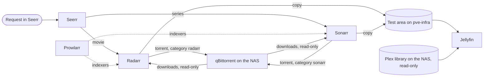

# Media services on pve-infra

> **ID:** GUIDE-media-stack · **Type:** guide · **Status:** current · **Updated:** 2026-11-27 · [Source](https://git.doku-lab.net/Homelab/homelab-iac/src/branch/main/docs/guides/media-stack.md)

A test of a self-hosted media chain beside Plex, which keeps running on the NAS untouched. Since 2026-11-27 each
service has its own unprivileged container on `pve-infra` (the operator's choice: separate guests in the Proxmox
tree). The first version, one Compose VM (`media-01`), is retired.

## What runs where

| Service | Container | Address | Installed from | Its data |
|---|---|---|---|---|
| Jellyfin | `jellyfin` (381) | 192.168.0.81:8096 | Jellyfin's Debian repository, version held | SQLite and metadata on the container's disk (`/var/lib/jellyfin`) |
| Seerr | `seerr` (382) | 192.168.0.82:5055 | built from the tagged source, pinned Node.js | PostgreSQL `seerr`; settings file in `/var/lib/seerr` |
| Radarr | `radarr` (383) | 192.168.0.83:7878 | the project's release archive | PostgreSQL `radarr`, `radarr_log` |
| Sonarr | `sonarr` (384) | 192.168.0.84:8989 | the project's release archive | PostgreSQL `sonarr`, `sonarr_log` |
| Prowlarr | `prowlarr` (385) | 192.168.0.85:9696 | the project's release archive | PostgreSQL `prowlarr`, `prowlarr_log` |
| qBittorrent | NAS app `qbit-vpn` | 192.168.0.13:8080 | the operator's own, behind a VPN | on the NAS ([TrueNAS guide](/docs/guides/truenas-metrics-alerts-and-apps-as-files)) |

Versions and checksums are in `ansible/vars/media.yml`. PostgreSQL is the shared cluster (`192.168.0.60`, TLS).
Jellyfin supports only SQLite.

## Names and sign-in

| Name | What | Sign-in |
|---|---|---|
| `https://jellyfin.doku-lab.net` | Jellyfin | its own accounts; `admin` (store path `/media`, `MEDIA_ADMIN_PASSWORD`) |
| `https://seerr.doku-lab.net` | Seerr | Jellyfin's accounts |
| `https://media.doku-lab.net/radarr/`, `/sonarr/`, `/prowlarr/` | the tools | Authentik (group `homelab-admins`) |

All from the LAN only. Jellyfin and Seerr are not behind Authentik: TV and phone apps cannot pass it. The three
tools keep a local `admin` (same password) and only answer Traefik, each other and the workstation.

## How a request travels



- Seerr is where a title is asked for. Radarr (movies) and Sonarr (series) keep the list of wanted titles, pick a
  release, follow the download and file the result. Prowlarr holds the indexers and pushes them to both.
- qBittorrent downloads on the NAS. Radarr and Sonarr read the finished download through a read-only share and
  **copy** it into the test area. A hard link is not possible: the downloads are on another machine and pool.
- Jellyfin shows the test area and the Plex library.

## Storage and the protection of the NAS

| What | On the node `pve-infra` | In the containers |
|---|---|---|
| Plex library (`/mnt/tank/plex_media`) | NFS, read-only: `/mnt/media-nas/plex` | Jellyfin: `/media/plex`, read-only |
| Downloads (`/mnt/fastpool/downloads`) | NFS, read-only: `/mnt/media-nas/downloads` | Radarr, Sonarr: `/downloads`, read-only |
| Test area | `/srv/media-test` (node's own disk) | Radarr, Sonarr: `/data/media`, read-write; Jellyfin: read-only |

- The NAS is read-only at three layers: the two shares are exported read-only to `192.168.0.12` alone, mounted
  read-only, and bound read-only. Radarr and Sonarr never see the Plex library at all.
- Nothing is removed from qBittorrent: the download client is set to leave finished and failed torrents.
- If the NAS is away, the mount points are empty, immutable directories; Jellyfin refuses to start on an empty
  library rather than drop it from its database.
- The test area is on the node's system disk (about 30 GiB free): enough for a test, not for a library.

## Operation

```
make media-status                                                     # services, health, mounts
scripts/secrets.py run /media /postgresql -- make media-configure MEDIA_CONFIGURE_APPROVED=yes
make media-mounts MEDIA_MOUNTS_APPROVED=yes                           # NAS shares, test area, graphics device
scripts/secrets.py run /media /homepage -- make media-connect MEDIA_CONNECT_APPROVED=yes
make media-backup                                                     # one archive on the workstation
make media-check                                                      # offline tests
```

- A new container: `media-plan` / `media-apply`, `media-hostkeys`, `media-configure`, `media-mounts`, `media-connect`.
- An update: new version and checksum in `ansible/vars/media.yml`, then `media-configure`.
- A container is reached with `ssh root@<address>` from the workstation, or from the Proxmox console.

## Indexers, and one safe test

Prowlarr has no indexer: add yours in Prowlarr → Indexers; they appear in Radarr and Sonarr by themselves.

1. In Seerr, request a title (for a series, pick the seasons).
2. Radarr or Sonarr shows it under `/data/media/test-movies` or `/data/media/test-series`.
3. qBittorrent on the NAS shows the torrent in the category `radarr` or `sonarr`.
4. When it is finished, the file is copied to the test area and appears in Jellyfin under "Test movies" or
   "Test series". The torrent stays in qBittorrent.

Everything a test writes is under `/srv/media-test` on the node, which can be emptied at any time.

## Hardware transcoding

Jellyfin uses the node's graphics device (`/dev/dri/renderD128`, Intel Jasper Lake) through VA-API with the
low-power encoders: H.264, HEVC 8/10-bit and VP9 decode, H.264 encode, no AV1. The node keeps the adapter (it is
not handed whole to a guest any more). The low-power encoders need the HuC firmware, which the node's driver loads only
with `enable_guc=2` (written by `make media-mounts`, effective after a restart of the node; until then a transcode
fails with "Driver does not support VBR RC mode"). **Not verified in the container yet.** To see it work: play something a device cannot play as it is, then
Jellyfin → Dashboard → Activity shows the transcode and its hardware method.

## Backup and restore

`make media-backup` writes `media-<time>.tar.zst` under `.local/media-backups`: Jellyfin's databases (consistent
copies) and configuration, Seerr's settings, and a dump of each of the seven PostgreSQL databases. It is run by
hand: the platform's backups are still to come (M012).

- A lost container: rebuild it (`media-apply`, `media-configure`, `media-mounts`); Radarr, Sonarr, Prowlarr and
  Seerr find their state in PostgreSQL again.
- Jellyfin: stop it, unpack `jellyfin.tar` over `/etc/jellyfin` and `/var/lib/jellyfin` (the `*.db.copy` files
  replace `data/*.db`), start it.
- A database: `pg_restore -h 192.168.0.60 -U <app> -d <database> --clean <file>.dump` from the app's container.

## Pulsarr

Pulsarr would be one more container beside Seerr: it reads Plex watchlists (with a Plex token) and turns them
into Radarr and Sonarr requests. It makes sense if Plex stays the place where people choose what to watch. Not
deployed.

## Verification

| Check | Command or place |
|---|---|
| Offline tests | `make media-check` |
| Services and mounts | `make media-status` |
| Connections, written only once | second `make media-connect` prints no `changed:` line |
| Routes | `https://media.doku-lab.net/radarr/` asks Authentik; ports 7878, 8989, 9696 refuse the LAN |
