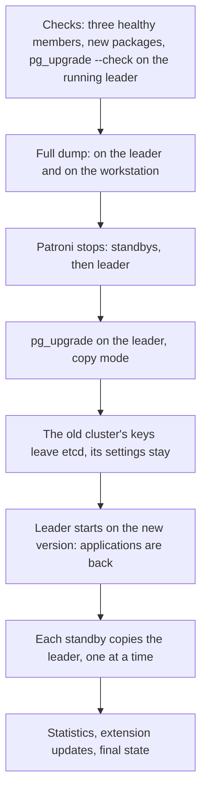

# PostgreSQL major-version upgrade

> **ID:** GUIDE-postgresql-major-version-upgrade-how-the-shared-cluster-move · **Type:** guide · **Status:** current · **Updated:** 2026-11-27 · [Source](https://git.doku-lab.net/Homelab/homelab-iac/src/branch/main/docs/guides/postgresql-major-version-upgrade-how-the-shared-cluster-move.md)

The shared cluster (`pg-01` to `pg-03`, Patroni, virtual IP `192.168.0.60`) runs **PostgreSQL 18** since
2026-11-27. This page says where the version comes from, how the cluster moves to the next one, and how it goes
back.

## Where the version comes from

| Software | Source | Why |
|---|---|---|
| PostgreSQL (`postgresql-18`, its client, `libpq5`) | the PostgreSQL project's repository, `apt.postgresql.org` (suite `trixie-pgdg`) | it carries every supported major version; Debian 13 has 17 only |
| Patroni, etcd, vip-manager, `postgresql-common` | Debian 13 | Debian's security updates; an apt pin lets nothing else through from the other repository |

The repository is verified with the key Debian ships in `postgresql-common`; nothing is downloaded to trust it.
A minor update (18.7 to 18.8) arrives with the members' normal package updates and needs a restart of
PostgreSQL through Patroni, one member at a time.

The number is `patroni_postgresql_version` in `ansible/roles/patroni_postgresql/defaults/main.yml`. **Changing it
is not an upgrade**: the data directory carries the version (`/var/lib/postgresql/<version>/doku-pg`), and
`make postgresql-configure` refuses a member that holds data of another version and none of the wanted one.

## The upgrade

```
# 1. raise patroni_postgresql_version in the role, commit
# 2. from the workstation:
scripts/secrets.py run /postgresql -- make postgresql-upgrade POSTGRESQL_UPGRADE_FROM=<running version> POSTGRESQL_UPGRADE_APPROVED=yes
```



- Nothing stops before the checks pass and the dump exists. `pg_upgrade --check` runs against the live leader.
- The applications have no database from C to F. On 2026-11-27 that was about one minute (1.4 GiB of data).
- Copy mode: the old data directory is never touched, on any member. It is the way back.
- The upgraded cluster has a new identifier, so Patroni's keys (leader, members, history) are removed from etcd;
  the cluster-wide settings (`config`) stay.
- The leader starts first and alone. A standby started first would create a new, empty cluster.

## What it leaves behind

| What | Where | Remove when |
|---|---|---|
| The old data directory | `/var/lib/postgresql/<old>/doku-pg` on every member | the applications are confirmed on the new version; then also the package `postgresql-<old>` |
| The dump (roles with password hashes, every database) | `.local/postgresql-backups/before-upgrade-<old>.sql.zst` on the workstation (0600, never in Git), and the same file in the working directory on the leader | with the old data directory |
| The working directory | `/var/lib/postgresql/upgrade-<old>-to-<new>` on the leader | with the old data directory |

Removing them is a deletion of data: only on the operator's word. Until then a second run refuses to start
("exists already").

## The way back

Possible as long as the old directories exist. Everything written after the upgrade is lost: the old cluster is
as it was when it stopped.

1. Stop Patroni on the three members (`sudo systemctl stop patroni`), standbys first.
2. Remove the cluster's keys from etcd, except `config` (the loop of the play "Upgrade the leader").
3. Start the **old leader** first, on the old version, then the others:
   `scripts/secrets.py run /postgresql -- make postgresql-configure POSTGRESQL_CONFIGURE_APPROVED=yes POSTGRESQL_CONFIGURE_ARGS="-e patroni_postgresql_version=<old> --limit <old leader>"`,
   then the same without `--limit`.
4. Put the old number back in the role.

Rehearsed on 2026-11-27 on a disposable cluster: the old leader came back on 17.12 with its 15 databases and
both standbys streaming.

## Rehearsing

A copy of `terraform/stacks/postgresql` under `.local/` with other names, VMIDs, addresses and virtual IP gives
three disposable members (the image is already on the nodes). Configure them on the old version, load
`pg_dumpall --no-role-passwords` of the real leader, run the playbook, destroy them. That is what was done before
the real run; it took about twenty minutes.

## What 17 to 18 showed (2026-11-27)

| | Rehearsal | Real cluster |
|---|---|---|
| Whole run | 2 min 42 s | 6 min 15 s |
| Applications without database | not measured | Authentik not ready for 57 s; Grafana 10 s |
| Result | 15 databases on 18.7, standbys streaming | 15 databases on 18.7, standbys streaming, virtual IP back on `pg-02` |

- Patroni 4.0.7 (Debian 13) runs PostgreSQL 18; no change of Patroni was needed.
- Extensions in use (`ltree`, `pg_trgm`, `pg_stat_statements`) are part of the server package; none needed an
  update.
- Every application reconnected by itself. No pod was restarted by hand.
