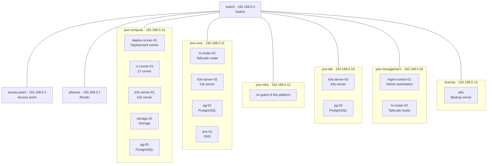

# homelab-iac

Infrastructure as Code for a self-hosted homelab under a **rolling rebuild**: the running infrastructure provisions
its replacement, one service at a time. OpenTofu creates the guests on the Proxmox cluster `doku-lab`, Ansible
configures them, k3s runs the applications and Argo CD keeps them equal to Git; Forgejo holds the source and runs CI.

**Proxmox → k3s → storage outside k3s → PostgreSQL + Patroni → Phase → Argo CD + Windmill → applications.**

This repository is the source of the documentation: the wikis are generated from `docs/`, `milestones/` and
`tasks/`. Where things stand today and what comes next: [handoff](handoff.md). Why the platform looks like this:
[project overview](project-overview.md) and [platform architecture](architecture/platform.md).

## Maps

Each map answers one question. Their tables and diagrams are not typed by hand: `make docs-maps` writes them from
the files that own the facts (the Argo CD applications, the Makefile, the DNS answers, the inventory page), and a
check fails when one of them no longer says what the repository says.

<!-- map:maps:start -->
| Map | Answers |
|---|---|
| [Architecture map](hubs/architecture-map.md) | How the pieces fit: the layers from the hardware to the applications, and which tool owns which concern. |
| [Infrastructure map](hubs/infrastructure-map.md) | Hosts, guests and how they are wired: which machine runs what, with its size and address. |
| [Service catalog](hubs/service-catalog.md) | Every service of the platform: its site, where it runs, what signs people in and where its data lives. |
| [Network and names](hubs/network-map.md) | Which name answers where: the LAN's DNS answers, the shared addresses and the route behind each name. |
| [Deployment map](hubs/deployment-map.md) | What deploys what: the OpenTofu root of each guest, the playbook that configures it and the Argo CD application of each service. |
| [Dependency map](hubs/dependency-map.md) | What needs what to run, the order in which the platform starts, and the order in which it was built. |
| [Identity and secrets map](hubs/identity-and-secrets-map.md) | Who signs in where and through what, and which secret-store path feeds which deployment. |
| [CI/CD map](hubs/ci-cd-map.md) | The Forgejo workflows, what starts them, which runner executes them and the checks they run. |
| [Architecture decisions](hubs/architecture-decisions.md) | Every decision record, its status and what it replaced. |
| [Operations](hubs/operations.md) | Day-to-day procedures: where the commands are, how to take a host down, what is known to be broken. |
| [Development history](hubs/development-history.md) | Milestones, the tasks under each and what is open now. |
<!-- map:maps:end -->

## The cluster at a glance

<!-- map:infrastructure-diagram:start -->

<!-- map:infrastructure-diagram:end -->

Details, sizes and addresses: [infrastructure map](hubs/infrastructure-map.md); every device, cable and address:
[infrastructure inventory](reference/infrastructure-inventory.md), written from NetBox.

## Working on the repository

| Need | Where |
|---|---|
| Current work, commands, known issues | [handoff](handoff.md) |
| Rules for people and agents | [AGENTS.md](../AGENTS.md) |
| Roadmap and progress | [development history](hubs/development-history.md), [dashboard](dashboard.md) |
| Every document by type | [knowledge map](knowledge-map.md) |
