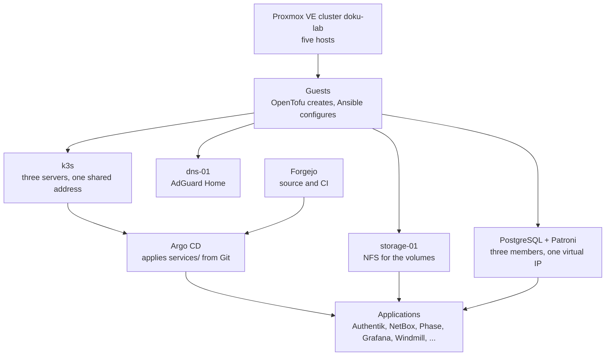

# Architecture map

> **ID:** GUIDE-map-architecture · **Type:** guide · **Status:** current · **Updated:** 2026-11-25 · [Source](https://git.doku-lab.net/Homelab/homelab-iac/src/branch/main/docs/hubs/architecture-map.md)

Start with the [platform architecture](/docs/architecture/platform): the target, its layers and owners, the key flows
and the constraints. The [project overview](/docs/project-overview) says why; the decisions are listed in
[architecture decisions](/docs/hubs/architecture-decisions).

## Layers

| Layer | What it is here | Owner | Map |
|---|---|---|---|
| Hardware and hypervisors | Five Proxmox VE hosts in the cluster `doku-lab`, one switch, pfSense, TrueNAS | People (NetBox records it) | [Infrastructure](/docs/hubs/infrastructure-map) |
| Guests | VMs and containers of the platform | OpenTofu roots, then Ansible | [Deployment](/docs/hubs/deployment-map) |
| Kubernetes | k3s with embedded etcd, Traefik as ingress | Ansible role `k3s` | [Infrastructure](/docs/hubs/infrastructure-map) |
| Data | NFS volumes on `storage-01`, PostgreSQL on three Patroni VMs, both outside k3s | OpenTofu and Ansible | [Dependencies](/docs/hubs/dependency-map) |
| Applications | Everything under `services/` | Argo CD | [Service catalog](/docs/hubs/service-catalog) |
| Names and edge | AdGuard Home answers the LAN names, Traefik routes them, cert-manager signs | Ansible (`dns`), Argo CD (`ingress`) | [Network and names](/docs/hubs/network-map) |
| Identity and secrets | Authentik signs people in, Phase holds the secrets | Git blueprints, `scripts/secrets.py` | [Identity and secrets](/docs/hubs/identity-and-secrets-map) |

## Responsibilities

One owner per concern; two tools never write the same object ([AGENTS.md](/agents), "Layer ownership").

| Responsibility | Component | Decision |
|---|---|---|
| Guests, disks, network cards | OpenTofu with `bpg/proxmox`, new roots only | [ADR-003](/docs/decisions/adr-003-opentofu-for-new-infrastructure) |
| Operating system, packages, users, k3s, runners | Ansible | [ADR-011](/docs/decisions/adr-011-k3s-first-argocd-headlamp) |
| Application topology | k3s reconciled by Argo CD | [ADR-011](/docs/decisions/adr-011-k3s-first-argocd-headlamp) |
| Persistent data | Storage outside k3s; TrueNAS only receives backups | [ADR-012](/docs/decisions/adr-012-external-nvme-storage-truenas-backups) |
| Databases | PostgreSQL 18 with Patroni on three VMs | [ADR-015](/docs/decisions/adr-015-postgresql-runs-on-three-patroni-vms-outside-k3s) |
| Source and CI | Forgejo, a validation runner and a deployment runner | [ADR-014](/docs/decisions/adr-014-dedicated-forgejo-deployment-runner), [ADR-008](/docs/decisions/adr-008-workstation-bootstrap-ct301-validation-only) |
| Secrets | Phase at run time, an encrypted bundle for recovery | [ADR-004](/docs/decisions/adr-004-secrets-phase-runtime-sops-bootstrap) |
| Inventory and addresses | NetBox, filled from Git and from what the machines report | [ADR-016](/docs/decisions/adr-016-netbox-is-the-inventory-and-ipam-source-of-truth-populated-f), [ADR-018](/docs/decisions/adr-018-netbox-holds-the-physical-inventory-git-says-what-a-device-i) |
| Single sign-on | Authentik, applications declared in Git | [ADR-017](/docs/decisions/adr-017-authentik-is-the-single-sign-on-of-the-platform-declared-in) |
| Forms and schedules | Windmill, never an infrastructure engine | [ADR-005](/docs/decisions/adr-005-windmill-service-catalog) |
| Operator workstation | `mgmt-control-01`, the only place that applies infrastructure | [ADR-009](/docs/decisions/adr-009-management-vm-gnome-admin-workstation), [ADR-002](/docs/decisions/adr-002-pve-management-standalone-host) |
