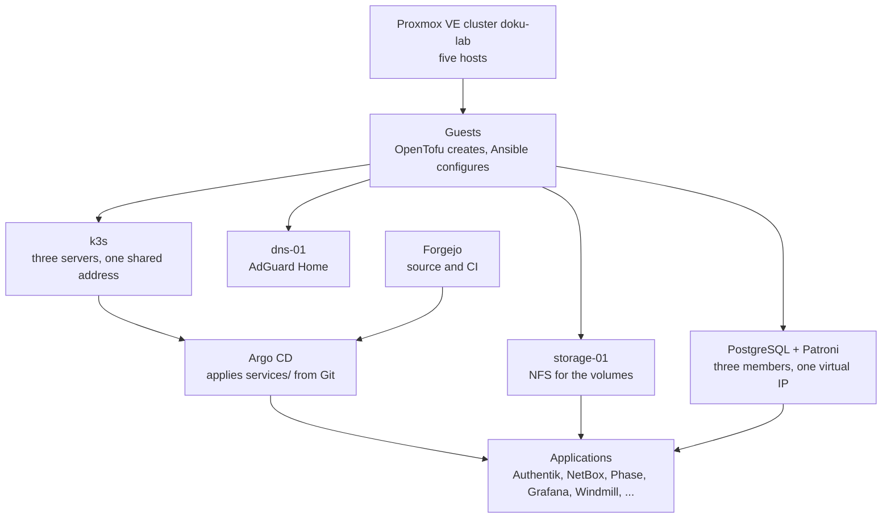

# Architecture map

Start with the [platform architecture](../architecture/platform.md): the target, its layers and owners, the key flows
and the constraints. The [project overview](../project-overview.md) says why; the decisions are listed in
[architecture decisions](architecture-decisions.md).

## Layers

| Layer | What it is here | Owner | Map |
|---|---|---|---|
| Hardware and hypervisors | Five Proxmox VE hosts in the cluster `doku-lab`, one switch, pfSense, TrueNAS | People (NetBox records it) | [Infrastructure](infrastructure-map.md) |
| Guests | VMs and containers of the platform | OpenTofu roots, then Ansible | [Deployment](deployment-map.md) |
| Kubernetes | k3s with embedded etcd, Traefik as ingress | Ansible role `k3s` | [Infrastructure](infrastructure-map.md) |
| Data | NFS volumes on `storage-01`, PostgreSQL on three Patroni VMs, both outside k3s | OpenTofu and Ansible | [Dependencies](dependency-map.md) |
| Applications | Everything under `services/` | Argo CD | [Service catalog](service-catalog.md) |
| Names and edge | AdGuard Home answers the LAN names, Traefik routes them, cert-manager signs | Ansible (`dns`), Argo CD (`ingress`) | [Network and names](network-map.md) |
| Identity and secrets | Authentik signs people in, Phase holds the secrets | Git blueprints, `scripts/secrets.py` | [Identity and secrets](identity-and-secrets-map.md) |

## Responsibilities

One owner per concern; two tools never write the same object ([AGENTS.md](../../AGENTS.md), "Layer ownership").

| Responsibility | Component | Decision |
|---|---|---|
| Guests, disks, network cards | OpenTofu with `bpg/proxmox`, new roots only | [ADR-003](../decisions/ADR-003-opentofu-for-new-infrastructure.md) |
| Operating system, packages, users, k3s, runners | Ansible | [ADR-011](../decisions/ADR-011-k3s-first-argocd-headlamp.md) |
| Application topology | k3s reconciled by Argo CD | [ADR-011](../decisions/ADR-011-k3s-first-argocd-headlamp.md) |
| Persistent data | Storage outside k3s; TrueNAS only receives backups | [ADR-012](../decisions/ADR-012-external-nvme-storage-truenas-backups.md) |
| Databases | PostgreSQL 18 with Patroni on three VMs | [ADR-015](../decisions/ADR-015-postgresql-runs-on-three-patroni-vms-outside-k3s.md) |
| Source and CI | Forgejo, a validation runner and a deployment runner | [ADR-014](../decisions/ADR-014-dedicated-forgejo-deployment-runner.md), [ADR-008](../decisions/ADR-008-workstation-bootstrap-ct301-validation-only.md) |
| Secrets | Phase at run time, an encrypted bundle for recovery | [ADR-004](../decisions/ADR-004-secrets-phase-runtime-sops-bootstrap.md) |
| Inventory and addresses | NetBox, filled from Git and from what the machines report | [ADR-016](../decisions/ADR-016-netbox-is-the-inventory-and-ipam-source-of-truth-populated-f.md), [ADR-018](../decisions/ADR-018-netbox-holds-the-physical-inventory-git-says-what-a-device-i.md) |
| Single sign-on | Authentik, applications declared in Git | [ADR-017](../decisions/ADR-017-authentik-is-the-single-sign-on-of-the-platform-declared-in.md) |
| Forms and schedules | Windmill, never an infrastructure engine | [ADR-005](../decisions/ADR-005-windmill-service-catalog.md) |
| Operator workstation | `mgmt-control-01`, the only place that applies infrastructure | [ADR-009](../decisions/ADR-009-management-vm-gnome-admin-workstation.md), [ADR-002](../decisions/ADR-002-pve-management-standalone-host.md) |
