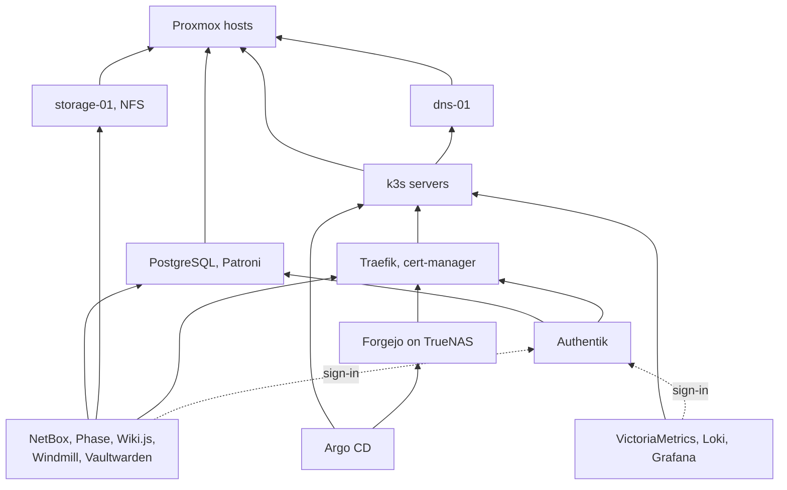
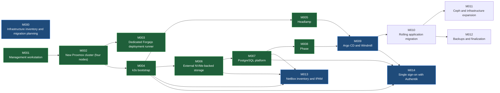

# Dependency map

> **ID:** GUIDE-map-dependencies · **Type:** guide · **Status:** current · **Updated:** 2026-11-25 · [Source](https://git.doku-lab.net/Homelab/homelab-iac/src/branch/main/docs/hubs/dependency-map.md)

## At run time

An arrow reads "needs". Nothing below k3s needs k3s: the data, the names and the workstation keep working when the
cluster is down.

- Every service keeps a local administrator: Authentik being down locks nobody out of the tools that repair it
  ([ADR-017](/docs/decisions/adr-017-authentik-is-the-single-sign-on-of-the-platform-declared-in)).
- No OpenTofu root needs NetBox to plan or apply ([ADR-016](/docs/decisions/adr-016-netbox-is-the-inventory-and-ipam-source-of-truth-populated-f)).
- Forgejo is reached through the ingress of the cluster it feeds: Argo CD keeps running what it already applied
  when Forgejo is away, and the workstation holds a full clone.

## Start order after a full stop

1. pfSense, the switch, the Proxmox hosts.
2. `dns-01`, then `storage-01` and the three PostgreSQL members.
3. The k3s servers; the shared address moves to whichever answers first.
4. Argo CD and the services follow by themselves.

Taking one host down for maintenance: see [operations](/docs/hubs/operations).

## Build order

The milestones and what each one waits for (green: completed, blue: active).

<!-- map:milestone-graph:start -->

<!-- map:milestone-graph:end -->
