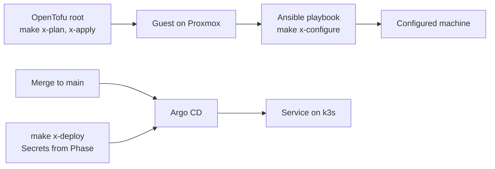

# Deployment map

> **ID:** GUIDE-map-deployment · **Type:** guide · **Status:** current · **Updated:** 2026-11-25 · [Source](https://git.doku-lab.net/Homelab/homelab-iac/src/branch/main/docs/hubs/deployment-map.md)

Three steps, each with its own tool, all started from the operator workstation through Make targets that ask for an
explicit approval variable. Plan before apply; nothing is applied by CI except the gated deployments of the
deployment runner.

## Guests: OpenTofu roots

State lives only on the workstation, one writer at a time. The legacy roots under `terraform/stacks/` that are not
listed here describe guests that are gone: never apply them.

<!-- map:roots:start -->
| OpenTofu root | Guests | Make targets, in order | Configured by |
|---|---|---|---|
| [`terraform/stacks/pve-management-control`](https://git.doku-lab.net/Homelab/homelab-iac/src/branch/main/terraform/stacks/pve-management-control/) | mgmt-control-01 | `make mgmt-check`, `make mgmt-plan`, `make mgmt-apply`, `make mgmt-configure` | [`configure-mgmt-control.yml`](https://git.doku-lab.net/Homelab/homelab-iac/src/branch/main/ansible/playbooks/configure-mgmt-control.yml) |
| [`terraform/stacks/deploy-runner`](https://git.doku-lab.net/Homelab/homelab-iac/src/branch/main/terraform/stacks/deploy-runner/) | deploy-runner-01 | `make deploy-runner-check`, `make deploy-runner-plan`, `make deploy-runner-apply`, `make deploy-runner-configure` | [`configure-deploy-runner.yml`](https://git.doku-lab.net/Homelab/homelab-iac/src/branch/main/ansible/playbooks/configure-deploy-runner.yml) |
| [`terraform/stacks/ci-runner`](https://git.doku-lab.net/Homelab/homelab-iac/src/branch/main/terraform/stacks/ci-runner/) | ci-runner-01 | `make ci-runner-check`, `make ci-runner-plan`, `make ci-runner-apply`, `make ci-runner-configure` | [`configure-ci-runner.yml`](https://git.doku-lab.net/Homelab/homelab-iac/src/branch/main/ansible/playbooks/configure-ci-runner.yml) |
| [`terraform/stacks/k3s`](https://git.doku-lab.net/Homelab/homelab-iac/src/branch/main/terraform/stacks/k3s/) | k3s-server-01, k3s-server-02, k3s-server-03 | `make k3s-cluster-check`, `make k3s-cluster-plan`, `make k3s-cluster-apply`, `make k3s-cluster-configure` | [`configure-k3s.yml`](https://git.doku-lab.net/Homelab/homelab-iac/src/branch/main/ansible/playbooks/configure-k3s.yml) |
| [`terraform/stacks/storage`](https://git.doku-lab.net/Homelab/homelab-iac/src/branch/main/terraform/stacks/storage/) | storage-01 | `make storage-check`, `make storage-plan`, `make storage-apply`, `make storage-configure` | [`configure-storage.yml`](https://git.doku-lab.net/Homelab/homelab-iac/src/branch/main/ansible/playbooks/configure-storage.yml) |
| [`terraform/stacks/postgresql`](https://git.doku-lab.net/Homelab/homelab-iac/src/branch/main/terraform/stacks/postgresql/) | pg-01, pg-02, pg-03 | `make postgresql-check`, `make postgresql-plan`, `make postgresql-apply`, `make postgresql-configure` | [`configure-postgresql.yml`](https://git.doku-lab.net/Homelab/homelab-iac/src/branch/main/ansible/playbooks/configure-postgresql.yml) |
| [`terraform/stacks/dns`](https://git.doku-lab.net/Homelab/homelab-iac/src/branch/main/terraform/stacks/dns/) | dns-01 | `make dns-check`, `make dns-plan`, `make dns-apply`, `make dns-configure` | [`configure-dns.yml`](https://git.doku-lab.net/Homelab/homelab-iac/src/branch/main/ansible/playbooks/configure-dns.yml) |
| [`terraform/stacks/media`](https://git.doku-lab.net/Homelab/homelab-iac/src/branch/main/terraform/stacks/media/) | media-01 | `make media-check`, `make media-plan`, `make media-apply`, `make media-configure` | [`configure-media.yml`](https://git.doku-lab.net/Homelab/homelab-iac/src/branch/main/ansible/playbooks/configure-media.yml) |
<!-- map:roots:end -->

Also configured by Ansible, without a root of their own yet: the two Tailscale routers
([`configure-tailscale-routers.yml`](https://git.doku-lab.net/Homelab/homelab-iac/src/branch/main/ansible/playbooks/configure-tailscale-routers.yml)) and the metrics and
log agent of every VM (`make observability-agents`).

## Services: Argo CD applications

A change merged to `main` is applied by Argo CD. The Make target is only needed the first time and when a Secret
changes: it writes the Secrets from the secret store, then hands the application to Argo CD.

<!-- map:applications:start -->
| Argo CD application | Values and manifests | Writes the Secrets, hands over to Argo CD | Secret store paths |
|---|---|---|---|
| [authentik](https://git.doku-lab.net/Homelab/homelab-iac/src/branch/main/services/argocd/apps/authentik.yaml) | [`services/authentik`](https://git.doku-lab.net/Homelab/homelab-iac/src/branch/main/services/authentik/) | `make authentik-deploy` | `/authentik`, `/postgresql` |
| [headlamp](https://git.doku-lab.net/Homelab/homelab-iac/src/branch/main/services/argocd/apps/headlamp.yaml) | [`services/headlamp`](https://git.doku-lab.net/Homelab/homelab-iac/src/branch/main/services/headlamp/) | `make headlamp-deploy` | `/authentik` |
| [homepage](https://git.doku-lab.net/Homelab/homelab-iac/src/branch/main/services/argocd/apps/homepage.yaml) | [`services/homepage`](https://git.doku-lab.net/Homelab/homelab-iac/src/branch/main/services/homepage/) | `make homepage-deploy` | `/`, `/homepage` |
| [ingress](https://git.doku-lab.net/Homelab/homelab-iac/src/branch/main/services/argocd/apps/ingress.yaml) | [`services/ingress`](https://git.doku-lab.net/Homelab/homelab-iac/src/branch/main/services/ingress/) | nothing: Argo CD needs no Secret for it |  |
| [monitoring](https://git.doku-lab.net/Homelab/homelab-iac/src/branch/main/services/argocd/apps/monitoring.yaml) | [`services/observability`](https://git.doku-lab.net/Homelab/homelab-iac/src/branch/main/services/observability/) | `make observability-deploy` | `/`, `/monitoring`, `/postgresql`, `/authentik`, `/switch`, `/truenas` |
| [netbox](https://git.doku-lab.net/Homelab/homelab-iac/src/branch/main/services/argocd/apps/netbox.yaml) | [`services/netbox`](https://git.doku-lab.net/Homelab/homelab-iac/src/branch/main/services/netbox/) | `make netbox-deploy` | `/netbox`, `/postgresql`, `/authentik` |
| [phase](https://git.doku-lab.net/Homelab/homelab-iac/src/branch/main/services/argocd/apps/phase.yaml) | [`services/phase`](https://git.doku-lab.net/Homelab/homelab-iac/src/branch/main/services/phase/) | `make phase-deploy` |  |
| [storage](https://git.doku-lab.net/Homelab/homelab-iac/src/branch/main/services/argocd/apps/storage.yaml) | [`services/storage`](https://git.doku-lab.net/Homelab/homelab-iac/src/branch/main/services/storage/) | nothing: Argo CD needs no Secret for it |  |
| [vaultwarden](https://git.doku-lab.net/Homelab/homelab-iac/src/branch/main/services/argocd/apps/vaultwarden.yaml) | [`services/vaultwarden`](https://git.doku-lab.net/Homelab/homelab-iac/src/branch/main/services/vaultwarden/) | `make vaultwarden-deploy` | `/postgresql` |
| [wiki](https://git.doku-lab.net/Homelab/homelab-iac/src/branch/main/services/argocd/apps/wiki.yaml) | [`services/wiki`](https://git.doku-lab.net/Homelab/homelab-iac/src/branch/main/services/wiki/) | `make wiki-deploy` | `/wiki`, `/postgresql` |
| [windmill](https://git.doku-lab.net/Homelab/homelab-iac/src/branch/main/services/argocd/apps/windmill.yaml) | [`services/windmill`](https://git.doku-lab.net/Homelab/homelab-iac/src/branch/main/services/windmill/) | `make windmill-deploy` | `/postgresql` |
<!-- map:applications:end -->
