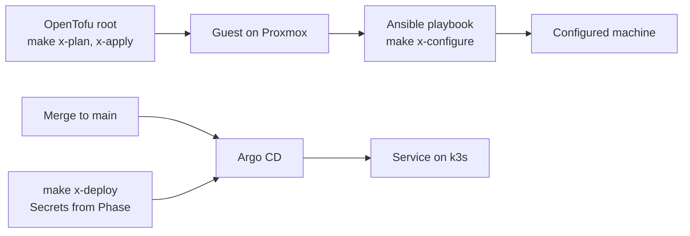

# Deployment map

Three steps, each with its own tool, all started from the operator workstation through Make targets that ask for an
explicit approval variable. Plan before apply; nothing is applied by CI except the gated deployments of the
deployment runner.

## Guests: OpenTofu roots

State lives only on the workstation, one writer at a time. The legacy roots under `terraform/stacks/` that are not
listed here describe guests that are gone: never apply them.

<!-- map:roots:start -->
| OpenTofu root | Guests | Make targets, in order | Configured by |
|---|---|---|---|
| [`terraform/stacks/pve-management-control`](../../terraform/stacks/pve-management-control) | mgmt-control-01 | `make mgmt-check`, `make mgmt-plan`, `make mgmt-apply`, `make mgmt-configure` | [`configure-mgmt-control.yml`](../../ansible/playbooks/configure-mgmt-control.yml) |
| [`terraform/stacks/deploy-runner`](../../terraform/stacks/deploy-runner) | deploy-runner-01 | `make deploy-runner-check`, `make deploy-runner-plan`, `make deploy-runner-apply`, `make deploy-runner-configure` | [`configure-deploy-runner.yml`](../../ansible/playbooks/configure-deploy-runner.yml) |
| [`terraform/stacks/ci-runner`](../../terraform/stacks/ci-runner) | ci-runner-01 | `make ci-runner-check`, `make ci-runner-plan`, `make ci-runner-apply`, `make ci-runner-configure` | [`configure-ci-runner.yml`](../../ansible/playbooks/configure-ci-runner.yml) |
| [`terraform/stacks/k3s`](../../terraform/stacks/k3s) | k3s-server-01, k3s-server-02, k3s-server-03 | `make k3s-cluster-check`, `make k3s-cluster-plan`, `make k3s-cluster-apply`, `make k3s-cluster-configure` | [`configure-k3s.yml`](../../ansible/playbooks/configure-k3s.yml) |
| [`terraform/stacks/storage`](../../terraform/stacks/storage) | storage-01 | `make storage-check`, `make storage-plan`, `make storage-apply`, `make storage-configure` | [`configure-storage.yml`](../../ansible/playbooks/configure-storage.yml) |
| [`terraform/stacks/postgresql`](../../terraform/stacks/postgresql) | pg-01, pg-02, pg-03 | `make postgresql-check`, `make postgresql-plan`, `make postgresql-apply`, `make postgresql-configure` | [`configure-postgresql.yml`](../../ansible/playbooks/configure-postgresql.yml) |
| [`terraform/stacks/dns`](../../terraform/stacks/dns) | dns-01 | `make dns-check`, `make dns-plan`, `make dns-apply`, `make dns-configure` | [`configure-dns.yml`](../../ansible/playbooks/configure-dns.yml) |
| [`terraform/stacks/media`](../../terraform/stacks/media) | media-01 | `make media-check`, `make media-plan`, `make media-apply`, `make media-configure` | [`configure-media.yml`](../../ansible/playbooks/configure-media.yml) |
<!-- map:roots:end -->

Also configured by Ansible, without a root of their own yet: the two Tailscale routers
([`configure-tailscale-routers.yml`](../../ansible/playbooks/configure-tailscale-routers.yml)) and the metrics and
log agent of every VM (`make observability-agents`).

## Services: Argo CD applications

A change merged to `main` is applied by Argo CD. The Make target is only needed the first time and when a Secret
changes: it writes the Secrets from the secret store, then hands the application to Argo CD.

<!-- map:applications:start -->
| Argo CD application | Values and manifests | Writes the Secrets, hands over to Argo CD | Secret store paths |
|---|---|---|---|
| [authentik](../../services/argocd/apps/authentik.yaml) | [`services/authentik`](../../services/authentik) | `make authentik-deploy` | `/authentik`, `/postgresql` |
| [headlamp](../../services/argocd/apps/headlamp.yaml) | [`services/headlamp`](../../services/headlamp) | `make headlamp-deploy` | `/authentik` |
| [homepage](../../services/argocd/apps/homepage.yaml) | [`services/homepage`](../../services/homepage) | `make homepage-deploy` | `/`, `/homepage` |
| [ingress](../../services/argocd/apps/ingress.yaml) | [`services/ingress`](../../services/ingress) | nothing: Argo CD needs no Secret for it |  |
| [monitoring](../../services/argocd/apps/monitoring.yaml) | [`services/observability`](../../services/observability) | `make observability-deploy` | `/`, `/monitoring`, `/postgresql`, `/authentik`, `/switch`, `/truenas` |
| [netbox](../../services/argocd/apps/netbox.yaml) | [`services/netbox`](../../services/netbox) | `make netbox-deploy` | `/netbox`, `/postgresql`, `/authentik` |
| [phase](../../services/argocd/apps/phase.yaml) | [`services/phase`](../../services/phase) | `make phase-deploy` |  |
| [storage](../../services/argocd/apps/storage.yaml) | [`services/storage`](../../services/storage) | nothing: Argo CD needs no Secret for it |  |
| [vaultwarden](../../services/argocd/apps/vaultwarden.yaml) | [`services/vaultwarden`](../../services/vaultwarden) | `make vaultwarden-deploy` | `/postgresql` |
| [wiki](../../services/argocd/apps/wiki.yaml) | [`services/wiki`](../../services/wiki) | `make wiki-deploy` | `/wiki`, `/postgresql` |
| [windmill](../../services/argocd/apps/windmill.yaml) | [`services/windmill`](../../services/windmill) | `make windmill-deploy` | `/postgresql` |
<!-- map:applications:end -->
