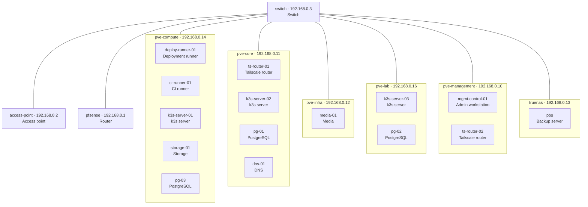

# Infrastructure map

The picture and the tables below come from the [infrastructure inventory](../reference/infrastructure-inventory.md),
which `make netbox-docs` writes from NetBox; NetBox itself follows the cluster every 15 minutes. A guest that was
moved shows on its new host here after the next `make netbox-docs`.

<!-- map:infrastructure-diagram:start -->

<!-- map:infrastructure-diagram:end -->

## Devices

<!-- map:hosts:start -->
| Device | Role | Model | Address | Guests of the platform | Notes |
|---|---|---|---|---|---|
| `access-point` | Access point | TP-Link EAP720 | 192.168.0.2 |  | Wi-Fi access point, managed on its own web interface |
| `pfsense` | Router | Lenovo ThinkCentre M75q Gen 2 | 192.168.0.1 |  | AMD Ryzen 3, 8 GB RAM. pfSense, LAN gateway and DHCP; never changed or signed in to by automation |
| `pve-compute` | Hypervisor | Custom build Tower, ASUS mainboard, Ryzen 9 9950X3D | 192.168.0.14 | deploy-runner-01, ci-runner-01, k3s-server-01, storage-01, pg-03 | AMD Ryzen 9 9950X3D, 32 threads, 30 GB usable RAM, 1 TB and 2 TB NVMe. The old environment until 2026-11-24 (then named pve-lab) |
| `pve-core` | Hypervisor | Lenovo ThinkStation P350 Tiny | 192.168.0.11 | ts-router-01, k3s-server-02, pg-01, dns-01 | Intel Core i7-11700, 32 GB RAM, 1 TB NVMe, a 25 Gb SFP28 card |
| `pve-infra` | Hypervisor | Beelink Mini S | 192.168.0.12 | media-01 | Intel Celeron N5095A, 8 GB RAM, 256 GB SATA SSD |
| `pve-lab` | Hypervisor | ORIGIMAGIC Nebula Series | 192.168.0.16 | k3s-server-03, pg-02 | AMD Ryzen 7 6800H, 28 GB usable RAM, 512 GB NVMe |
| `pve-management` | Hypervisor | Lenovo ThinkCentre M90q | 192.168.0.10 | mgmt-control-01, ts-router-02 | Intel Core i5-10500T, 16 GB RAM, 256 GB NVMe; hosts the admin workstation (ADR-002) |
| `switch` | Switch | QNAP QSW-M3216R-8S8T | 192.168.0.3 |  | Core switch; every Proxmox host of doku-lab is plugged into it |
| `truenas` | NAS | Custom build NAS, ASRock N100M mainboard | 192.168.0.13 | pbs | TrueNAS: Forgejo, Nextcloud, Plex, qBittorrent; pools tank (2 x 8 TB mirror), fastpool (1 TB), apps-pool (180 GB). Not built from this repository |
<!-- map:hosts:end -->

`pve-lab` is the holding node: guests of a host under maintenance are parked there, experiments run there, and the
other hosts are kept as stable as possible. `pve-management` hosts the operator workstation and stays apart
([ADR-002](../decisions/ADR-002-pve-management-standalone-host.md)).

## Guests of the platform

<!-- map:guests:start -->
| Guest | VMID | Host | Role | Address | vCPU | Memory | Disk | Status | Defined by |
|---|---|---|---|---|---|---|---|---|---|
| `mgmt-control-01` | 100 | pve-management | Admin workstation | 192.168.0.39 | 12 | 10 GB | 120 GB | Active | [`terraform/stacks/pve-management-control`](../../terraform/stacks/pve-management-control) |
| `deploy-runner-01` | 302 | pve-compute | Deployment runner | 192.168.0.32 | 6 | 4 GB | 24 GB | Active | [`terraform/stacks/deploy-runner`](../../terraform/stacks/deploy-runner) |
| `ci-runner-01` | 303 | pve-compute | CI runner | 192.168.0.33 | 4 | 6 GB | 48 GB | Active | [`terraform/stacks/ci-runner`](../../terraform/stacks/ci-runner) |
| `ts-router-01` | 306 | pve-core | Tailscale router | 192.168.0.36 | 1 | 0.5 GB | 8 GB | Active | Tailscale subnet router for the LAN (ansible/playbooks/configure-tailscale-routers.yml); container moved from the old host on 2026-11-21, not defined by a root yet |
| `ts-router-02` | 307 | pve-management | Tailscale router | 192.168.0.37 | 1 | 0.5 GB | 8 GB | Active | Tailscale subnet router for the LAN (ansible/playbooks/configure-tailscale-routers.yml); container moved from the old host on 2026-11-21, not defined by a root yet |
| `k3s-server-01` | 310 | pve-compute | k3s server | 192.168.0.40 | 6 | 12 GB | 64 GB | Active | [`terraform/stacks/k3s`](../../terraform/stacks/k3s) |
| `k3s-server-02` | 311 | pve-core | k3s server | 192.168.0.41 | 4 | 8 GB | 64 GB | Active | [`terraform/stacks/k3s`](../../terraform/stacks/k3s) |
| `k3s-server-03` | 312 | pve-lab | k3s server | 192.168.0.42 | 4 | 6 GB | 64 GB | Active | [`terraform/stacks/k3s`](../../terraform/stacks/k3s) |
| `storage-01` | 350 | pve-compute | Storage | 192.168.0.50 | 2 | 2 GB | 316 GB | Active | [`terraform/stacks/storage`](../../terraform/stacks/storage) |
| `pg-01` | 361 | pve-core | PostgreSQL | 192.168.0.61 | 2 | 4 GB | 56 GB | Active | [`terraform/stacks/postgresql`](../../terraform/stacks/postgresql) |
| `pg-02` | 362 | pve-lab | PostgreSQL | 192.168.0.62 | 2 | 4 GB | 56 GB | Active | [`terraform/stacks/postgresql`](../../terraform/stacks/postgresql) |
| `pg-03` | 363 | pve-compute | PostgreSQL | 192.168.0.63 | 2 | 2 GB | 56 GB | Active | [`terraform/stacks/postgresql`](../../terraform/stacks/postgresql) |
| `dns-01` | 370 | pve-core | DNS | 192.168.0.70 | 1 | 1 GB | 16 GB | Active | [`terraform/stacks/dns`](../../terraform/stacks/dns) |
| `media-01` | 380 | pve-infra | Media | 192.168.0.80 | 4 | 5.5 GB | 156 GB | Active | [`terraform/stacks/media`](../../terraform/stacks/media) |
| `pbs` |  | truenas | Backup server | 192.168.0.15 | 2 | 4 GB |  | Offline | Proxmox Backup Server, a VM on TrueNAS. Stopped: its backup disk failed in November 2026 |
<!-- map:guests:end -->

Desktop and template machines are in NetBox and are not listed. Serial numbers and hardware addresses are in
NetBox only.

## Shared addresses

| Address | Held by | For |
|---|---|---|
| 192.168.0.45 | one of the three k3s servers at a time (kube-vip) | the Kubernetes API and the ingress: every `*.doku-lab.net` name of the platform |
| 192.168.0.60 | the PostgreSQL leader (Patroni, keepalived) | every database client |
| 192.168.0.20 | `dns-01` | the LAN's DNS |

More: [network and names](network-map.md). Where each guest is defined and how it is applied:
[deployment map](deployment-map.md).
