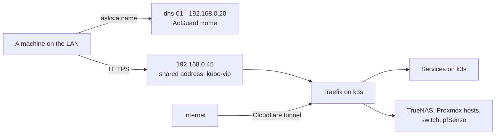

# Network and names

> **ID:** GUIDE-map-network · **Type:** guide · **Status:** current · **Updated:** 2026-11-25 · [Source](https://git.doku-lab.net/Homelab/homelab-iac/src/branch/main/docs/hubs/network-map.md)

One LAN, 192.168.0.0/24, behind pfSense (never changed by automation). `dns-01` answers the names below for the LAN;
almost all of them point at the cluster's shared address, where Traefik picks the route and presents the
certificate that cert-manager keeps valid.

## Names answered on the LAN

From [`ansible/vars/dns.yml`](https://git.doku-lab.net/Homelab/homelab-iac/src/branch/main/ansible/vars/dns.yml) (`make dns-configure` writes it to AdGuard Home); the route
is the file that names the host for Traefik.

<!-- map:names:start -->
| Name | LAN answer | Answered by | Route |
|---|---|---|---|
| `adguard.doku-lab.net` | 192.168.0.20 | dns-01 (AdGuard Home) |  |
| `argocd.doku-lab.net` | 192.168.0.45 | Traefik on k3s (shared address) | [`services/argocd/access.yaml`](https://git.doku-lab.net/Homelab/homelab-iac/src/branch/main/services/argocd/access.yaml) |
| `auth.doku-lab.net` | 192.168.0.45 | Traefik on k3s (shared address) | [`services/authentik/access.yaml`](https://git.doku-lab.net/Homelab/homelab-iac/src/branch/main/services/authentik/access.yaml) |
| `cloud.doku-lab.net` | 192.168.0.45 | Traefik on k3s (shared address) | [`services/ingress/legacy-routes.yaml`](https://git.doku-lab.net/Homelab/homelab-iac/src/branch/main/services/ingress/legacy-routes.yaml) |
| `dropper.doku-lab.net` | 192.168.0.45 | Traefik on k3s (shared address) | [`services/ingress/legacy-routes.yaml`](https://git.doku-lab.net/Homelab/homelab-iac/src/branch/main/services/ingress/legacy-routes.yaml) |
| `git.doku-lab.net` | 192.168.0.45 | Traefik on k3s (shared address) | [`services/ingress/legacy-routes.yaml`](https://git.doku-lab.net/Homelab/homelab-iac/src/branch/main/services/ingress/legacy-routes.yaml) |
| `grafana.doku-lab.net` | 192.168.0.45 | Traefik on k3s (shared address) | [`services/observability/access.yaml`](https://git.doku-lab.net/Homelab/homelab-iac/src/branch/main/services/observability/access.yaml) |
| `headlamp.doku-lab.net` | 192.168.0.45 | Traefik on k3s (shared address) | [`services/headlamp/values.yaml`](https://git.doku-lab.net/Homelab/homelab-iac/src/branch/main/services/headlamp/values.yaml) |
| `home.doku-lab.net` | 192.168.0.45 | Traefik on k3s (shared address) | [`services/homepage/access.yaml`](https://git.doku-lab.net/Homelab/homelab-iac/src/branch/main/services/homepage/access.yaml) |
| `homepage.doku-lab.net` | 192.168.0.45 | Traefik on k3s (shared address) | [`services/homepage/access.yaml`](https://git.doku-lab.net/Homelab/homelab-iac/src/branch/main/services/homepage/access.yaml) |
| `netbox.doku-lab.net` | 192.168.0.45 | Traefik on k3s (shared address) | [`services/netbox/access.yaml`](https://git.doku-lab.net/Homelab/homelab-iac/src/branch/main/services/netbox/access.yaml) |
| `pbs.doku-lab.net` | 192.168.0.45 | Traefik on k3s (shared address) | [`services/ingress/legacy-routes.yaml`](https://git.doku-lab.net/Homelab/homelab-iac/src/branch/main/services/ingress/legacy-routes.yaml) |
| `pfsense.doku-lab.net` | 192.168.0.45 | Traefik on k3s (shared address) | [`services/ingress/legacy-routes.yaml`](https://git.doku-lab.net/Homelab/homelab-iac/src/branch/main/services/ingress/legacy-routes.yaml) |
| `phase.doku-lab.net` | 192.168.0.45 | Traefik on k3s (shared address) | [`services/phase/access.yaml`](https://git.doku-lab.net/Homelab/homelab-iac/src/branch/main/services/phase/access.yaml) |
| `plex.doku-lab.net` | 192.168.0.45 | Traefik on k3s (shared address) | [`services/ingress/legacy-routes.yaml`](https://git.doku-lab.net/Homelab/homelab-iac/src/branch/main/services/ingress/legacy-routes.yaml) |
| `pve-compute.doku-lab.net` | 192.168.0.45 | Traefik on k3s (shared address) | [`services/ingress/proxmox-routes.yaml`](https://git.doku-lab.net/Homelab/homelab-iac/src/branch/main/services/ingress/proxmox-routes.yaml) |
| `pve-core.doku-lab.net` | 192.168.0.45 | Traefik on k3s (shared address) | [`services/ingress/proxmox-routes.yaml`](https://git.doku-lab.net/Homelab/homelab-iac/src/branch/main/services/ingress/proxmox-routes.yaml) |
| `pve-infra.doku-lab.net` | 192.168.0.45 | Traefik on k3s (shared address) | [`services/ingress/proxmox-routes.yaml`](https://git.doku-lab.net/Homelab/homelab-iac/src/branch/main/services/ingress/proxmox-routes.yaml) |
| `pve-lab.doku-lab.net` | 192.168.0.45 | Traefik on k3s (shared address) | [`services/ingress/proxmox-routes.yaml`](https://git.doku-lab.net/Homelab/homelab-iac/src/branch/main/services/ingress/proxmox-routes.yaml) |
| `pve-management.doku-lab.net` | 192.168.0.45 | Traefik on k3s (shared address) | [`services/ingress/proxmox-routes.yaml`](https://git.doku-lab.net/Homelab/homelab-iac/src/branch/main/services/ingress/proxmox-routes.yaml) |
| `qbit.doku-lab.net` | 192.168.0.45 | Traefik on k3s (shared address) | [`services/ingress/legacy-routes.yaml`](https://git.doku-lab.net/Homelab/homelab-iac/src/branch/main/services/ingress/legacy-routes.yaml) |
| `switch.doku-lab.net` | 192.168.0.45 | Traefik on k3s (shared address) | [`services/ingress/legacy-routes.yaml`](https://git.doku-lab.net/Homelab/homelab-iac/src/branch/main/services/ingress/legacy-routes.yaml) |
| `truenas.doku-lab.net` | 192.168.0.45 | Traefik on k3s (shared address) | [`services/ingress/legacy-routes.yaml`](https://git.doku-lab.net/Homelab/homelab-iac/src/branch/main/services/ingress/legacy-routes.yaml) |
| `vault.doku-lab.net` | 192.168.0.45 | Traefik on k3s (shared address) | [`services/vaultwarden/vaultwarden.yaml`](https://git.doku-lab.net/Homelab/homelab-iac/src/branch/main/services/vaultwarden/vaultwarden.yaml) |
| `wiki.doku-lab.net` | 192.168.0.45 | Traefik on k3s (shared address) | [`services/wiki/access.yaml`](https://git.doku-lab.net/Homelab/homelab-iac/src/branch/main/services/wiki/access.yaml) |
| `windmill.doku-lab.net` | 192.168.0.45 | Traefik on k3s (shared address) | [`services/windmill/access.yaml`](https://git.doku-lab.net/Homelab/homelab-iac/src/branch/main/services/windmill/access.yaml) |
<!-- map:names:end -->

Addresses, ranges and prefixes: [infrastructure inventory](/docs/reference/infrastructure-inventory) ("Networks",
"Addresses"). Known network problem: see [operations](/docs/hubs/operations).
